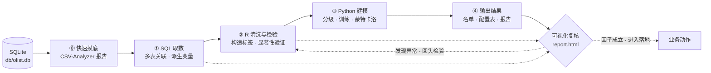

# 巴西电商 Olist 订单数据分析

基于 Kaggle Olist 公开数据集（2016-09 ~ 2018-08，约 10 万笔订单），围绕平台真实经营痛点做归因分析与方案测算。

**读法：一个根目录文件夹 = 一个分析层面 = 一条完整的「提问 → 归因 → 建模 → 算账 → 落地」链路。** 各层面之间数据口径打通、结论互相引用，逐层深入同一批订单。

---

## 一、项目地图

### 主线：履约时效性（三层递进）

| 层面 | 目录 | 要回答的问题 | 状态 |
|---|---|---|---|
| ① **责任归因** | [`延迟率分析/`](%E5%BB%B6%E8%BF%9F%E7%8E%87%E5%88%86%E6%9E%90/) | 延迟是谁的责任？砍卖家、改线路还是调时效？ | 已完成 |
| ② **算法重构** | [`运送预期算法优化/`](%E8%BF%90%E9%80%81%E9%A2%84%E6%9C%9F%E7%AE%97%E6%B3%95%E4%BC%98%E5%8C%96/) | 现有 ETA 算得准吗？能不能自己训一个更好的？ | 已完成 |
| ③ **收益决策** | [`延迟率分析/GMV_analysis/`](%E5%BB%B6%E8%BF%9F%E7%8E%87%E5%88%86%E6%9E%90/GMV_analysis/) | 给旧算法打补丁和直接换算法，哪个更划算？ | 已完成 |

### 支线：其他经营层面

| 层面 | 目录 | 要回答的问题 | 状态 |
|---|---|---|---|
| ④ **客户复购** | [`客户分析以及复购率判断/`](%E5%AE%A2%E6%88%B7%E5%88%86%E6%9E%90%E4%BB%A5%E5%8F%8A%E5%A4%8D%E8%B4%AD%E7%8E%87%E5%88%A4%E6%96%AD/) | 谁有救、什么时候召回、首单这笔账划不划算 | 已完成 |
| ⑤ **品类差评** | [`商品品类层面分析差评/`](%E5%95%86%E5%93%81%E5%93%81%E7%B1%BB%E5%B1%82%E9%9D%A2%E5%88%86%E6%9E%90%E5%B7%AE%E8%AF%84/) | 哪些品类在制造差评 | 进行中（仅建库脚本） |

### 基础设施

| 路径 | 说明 |
|---|---|
| [`create_db.py`](create_db.py) | 原始 CSV → SQLite 建库 |
| [`db/olist.db`](%E5%BB%B6%E8%BF%9F%E7%8E%87%E5%88%86%E6%9E%90/) | SQLite 数据库，9 张表 |
| [`data/raw/`](data/raw/) | 原始 CSV |
| [`数据字典.html`](%E6%95%B0%E6%8D%AE%E5%AD%97%E5%85%B8.html) | 表结构、字段释义、关联关系 |
| [`业务痛点与提问清单.md`](%E4%B8%9A%E5%8A%A1%E7%97%9B%E7%82%B9%E4%B8%8E%E6%8F%90%E9%97%AE%E6%B8%85%E5%8D%95.md) | 全部分析的起点：痛点清单与待答问题 |

---

## 二、三条主线程做了什么

### 层面 ① 责任归因与短期止血 → [`延迟率分析/初步报告.md`](%E5%BB%B6%E8%BF%9F%E7%8E%87%E5%88%86%E6%9E%90/%E5%88%9D%E6%AD%A5%E6%8A%A5%E5%91%8A.md)

**做法**：SQL 多表关联派生距离与分段时长 → R 用 `case_when` 构造四象限归因标签（纯发货／纯物流／共责／潜在发货风险），再用卡方检验、有序逻辑回归、二分类逻辑回归验证显著性 → Python 做分级与延时方案求解。

**输出**：
- 延迟订单 1 星率 **47.15%** vs 准时 6.71%，平均评分 2.41 vs 4.26
- **延迟天数的评分杀伤是绝对周期的 2.4 倍**（延迟每多 1 天高分概率 −11.5%，总路程多 1 天仅 −5%）——买家「极度厌恶晚到」，而非厌恶慢
- 距离每 +1,000 km，超时几率 +50%（OR=1.0004）；发货州、商品类型、卖家个体均极显著
- 商家四象限名单｜商品四象限名单｜线路级延时配置表（见 [`商品层面分析结果/`](%E5%BB%B6%E8%BF%9F%E7%8E%87%E5%88%86%E6%9E%90/%E5%95%86%E5%93%81%E5%B1%82%E9%9D%A2%E5%88%86%E6%9E%90%E7%BB%93%E6%9E%9C)、[`商家层面分析结果_订单级归因/`](%E5%BB%B6%E8%BF%9F%E7%8E%87%E5%88%86%E6%9E%90/%E5%95%86%E5%AE%B6%E5%B1%82%E9%9D%A2%E5%88%86%E6%9E%90%E7%BB%93%E6%9E%9C_%E8%AE%A2%E5%8D%95%E7%BA%A7%E5%BD%92%E5%9B%A0)、[`线路延迟预送时间推荐结果/`](%E5%BB%B6%E8%BF%9F%E7%8E%87%E5%88%86%E6%9E%90/%E7%BA%BF%E8%B7%AF%E5%BB%B6%E8%BF%9F%E9%A2%84%E9%80%81%E6%97%B6%E9%97%B4%E6%8E%A8%E8%8D%90%E7%BB%93%E6%9E%9C)）
- ETA 延时三方案账本：A 全量+2 天 −46.5 万／B 仅物流单 −3.5 万／C 线路阶梯 −32.6 万，挽救率均为 26.89% 上下

**关键转折**：订单级归因显示纯物流仅占 6.9%、卖家发货责任合计 9.1%，A 类高风险卖家 117 家只贡献 5.8% 的超时单。**杠杆不在清退卖家，而在"承诺本身算错了"** —— 这直接催生了层面 ②。

### 层面 ② ETA 算法重构 → [`运送预期算法优化/分析.md`](%E8%BF%90%E9%80%81%E9%A2%84%E6%9C%9F%E7%AE%97%E6%B3%95%E4%BC%98%E5%8C%96/%E5%88%86%E6%9E%90.md)

**做法**：R 构造 8 大类特征（对数变换平滑长尾、滑动窗口衡量平台/卖家压力、黑五专项、按 OD 对的贝叶斯平滑路线 P90 与超时率、大件/偏远/国际标签）→ Python + LightGBM，对数目标 + 自建非对称 Pseudo-Huber 损失（**低估重罚 5x / 20x / 40x，高估轻罚 1x**）→ 折到日期再反算承诺，与原算法同构对比。

**输出**（测试集）：L1 MAE **3.392 天** vs 原算法 **10.890 天**；20x 延迟率 2.723%、MAE 8.075。原算法平均承诺 18.71 天 vs 真实 8.41 天，系统性高估一倍。

**诚实口径**是这一层的核心工作。用时间序列 5 折前向链重训（[`src/oof_val.py`](%E8%BF%90%E9%80%81%E9%A2%84%E6%9C%9F%E7%AE%97%E6%B3%95%E4%BC%98%E5%8C%96/src/oof_val.py)）后发现，全量回填的延迟率含样本内乐观：

| 口径 | 20x 延迟率 | 原算法 |
|---|---:|---:|
| 全量（含样本内） | 3.55% | 9.41% |
| 时间外测试期 | 2.11% | 6.50% |
| **折外（5 折前向链）** | **9.09%** | **9.64%** |

**诊断结论**（分桶 + 损失梯度表）：落差既不来自极端订单也非长尾失控 —— 折外模型在 **10~25 天主力区间（占 41% 订单）少承诺约 3 天**，根源是一年内真实配送均值从 16.96 天掉到 7.74 天的**分布漂移**，前向链训练使时效基准永远滞后。因此对极端离群值（P99 47.21 天、最长 208.35 天、偏度 2.81）**不应加大惩罚** —— Pseudo-Huber 的梯度本就刻意饱和（残差从 65% 涨到 348%，40x 梯度仅从 7.43 增至 7.93），加罚只会拟合噪声并牺牲 99% 常规订单。该做的是缩短重训周期、加时间衰减权重。

### 层面 ③ GMV 统一账本 → [`延迟率分析/GMV_analysis/GMV分析报告.md`](%E5%BB%B6%E8%BF%9F%E7%8E%87%E5%88%86%E6%9E%90/GMV_analysis/GMV%E5%88%86%E6%9E%90%E6%8A%A5%E5%91%8A.md)

**做法**：把层面 ① 的延时补丁与层面 ② 的新模型放进同一本账 —— 统一以「客户看到的承诺天数」为输入，用**等效天数折算** + 复利流失模型算转化损益，**10,000 次蒙特卡洛**同时扰动单量与日流失率，再用敏感性网格与二分法求盈亏平衡。另外两点口径需要交代：延迟判定统一改用「四舍五入到整天」口径（与 GMV 表的送达状态列 100% 吻合，此前的连续口径相差约 0.4 个百分点），并同时报告全量、时间外、折外三种稳健性口径。

**输出**（10 个场景，基准 Gmv 1,169.7 万元）：

| 路线 | 代表场景 | 延迟率 | ΔGMV |
|---|---|---:|---:|
| 延时补丁 | 方案 A 全量+2 天 | 6.66% | **−46.5 万** |
| 延时补丁 | 方案 B 仅物流单 | 7.26% | −3.4 万 |
| **换算法** | **20x（推荐）** | **3.21%** | **+62.4 万** |
| 换算法 | L1（陷阱） | 25.75% | +202.8 万 |

**方向完全相反**：延时是花钱买挽救（负收益概率 99.96%），换算法是砍掉过长承诺、GMV 反涨（负收益概率 0%）。L1 收益最高却是陷阱 —— 净减少延迟单为 **−12,185**，把 14,116 单原本守约的订单坑成违约。

**已知边界**：换 20x 的真实收益主要来自转化提升，而「缩短能提转化」是未经实测的假设。盈亏平衡门槛给出可验证的一道题：**20x 需要减时增益 ≥ 加时流失的 44%（封顶 14 天）/ 59%（不封顶）才净赚**，L1 只要 6%、40x 要 61%。 λ=0.3 时 20x 转亏。

### 支线 ④ 客户复购

复购率 3.12% 被观察期稀释，按 cohort 校正后观察满 6 个月约 3.7%；34% 的「复购」实为同日拆单。首单评分与复购呈非单调关系，客单价越高复购率反而越低（<100 元 3.99% → >1,000 元 1.90%）。

---

## 三、总体思路

每个层面都走同一条三段式流水线，各段各司其职：

```
SQLite 取数构造变量  →  R 清洗与统计检验  →  Python 建模输出结果
```

**① SQL：取数 + 构造变量** —— 直接从 `db/olist.db` 写 SQL 完成多表关联和特征派生，而不是导出后再拼。用 `geolocation` 经纬度算球面距离、用五个时间戳算审批/发货/运送各段时长、按 `order_id` 聚合避免一对多放大行数。

**② R：数据清洗 + 统计验证** —— 负责判断"这个因子到底有没有用"。构造归因标签后，用卡方检验、Wilcoxon、GLM 优势比模型验证显著性，**通过的因子才进入下一步**。

<<<<<<< HEAD
**③ Python：建模 + 输出** —— 做规则分级、优化求解、机器学习与蒙特卡洛模拟，产出可直接落地的名单与配置表。
=======
**③ Python：建模 + 输出**
做规则分级、优化求解和蒙特卡洛模拟，产出可直接落地的名单与配置表。

**贯穿全程的可视化挑因子**：`*_data.py` 系列脚本按州、品类、时间峰值、评分区间等维度分别聚合，喂给 `report.html` / `dashboard.html` 可视化看板。先看图发现异常（比如 2018 年 2-3 月延迟率突增到 21%），再回头用 R 检验、用 Python 构造特征——**看图提假设、统计做验证、建模出结果**。

## 三、目录结构

```
create_db.py                    CSV → SQLite 建库（输出到 db/olist.db）
db/olist.db                     SQLite 数据库，9 张表
data/raw/                       原始 CSV


延迟率分析/                      主线一：履约延迟
  src/快递过程分析.sql            取数：距离、时长、归因变量
  src/data_processed.r           R：归因标签构造 + 显著性检验
  src/identify_express_risks_data.py   线路风险识别与延时方案求解
  src/precise_gmv_simulated.py   ETA 调整三方案蒙特卡洛
  初步报告.md                     完整结论报告


客户分析以及复购率判断/            主线二：客户复购
  src/客户留存数据选取.sql         取数：客户级订单宽表
  src/data_processed.R           R：清洗与复购特征构造
  src/time_series_repurchase.py  复购间隔分布
  src/customer_eval.py           客单分层与高价值名单
```
产生的数据文件、可视化报告均未上传，在初步报告中有总体思路和大致结论。

## 四、执行流程

每个问题基本按下面这条链路走一遍，虚线是反馈回路：
>>>>>>> 8e7adda1574cc0087ef8fc17b5490d4b54216c76



**可视化不是最后一步，而是贯穿全程的复核环节**：看图提假设、统计做验证、建模出结果。2018 年 2–3 月延迟率突增到 21%（见 [`2018-2 3异常高延迟报告/`](%E5%BB%B6%E8%BF%9F%E7%8E%87%E5%88%86%E6%9E%90/2018-2%203%E5%BC%82%E5%B8%B8%E9%AB%98%E5%BB%B6%E8%BF%9F%E6%8A%A5%E5%91%8A/)）就是这么发现的，再回头用 R 检验、用 Python 构造黑五与峰值特征。

**闭环关系**：层面 ① 证明责任在"承诺算错" → 触发层面 ② 重训 ETA；层面 ② 给出可选模型档位 → 层面 ③ 用同一本 GMV 账比出该选哪一档。上游层的中间产物（名单、配置表、预测表）都是下游层的直接输入。

---

## 四、工具与语言

| 工具 | 承担角色 | 用在哪一层 |
|---|---|---|
| **SQL（SQLite）** | 多表关联、变量派生、避免行数放大 | 全部层的入口 |
| **R**（tidyverse / data.table） | 特征构造、归因标签、显著性检验 | ① 全部；② `delay_distribution.R` 特征工程 |
| **Python** — pandas / numpy | 数据处理、行对齐、口径校准 | 全部层 |
| **Python** — scikit-learn | 评估指标、基线对照 | ②③ |
| **LightGBM** | 自定义非对称损失的主模型 | ② 核心 |
| **statsmodels / scipy** | 有序逻辑回归、GLM 优势比、卡方 | ① |
| **PyTorch** — AdamW + warmup + 余弦退火 | 二阶段 MoE 路由分类器 | ② 分支探索 |
| **matplotlib / seaborn** | 全部中文化图表 | 全部层 |
| **自研 CSV-Analyzer** | 数据摸底自动化 | 见下 |

### 自研 CSV-Analyzer 的结合使用

[CSV-Analyzer](../CSV-Analyzer-0.1.0)（轻量 CSV 自动分析工具，[README](../CSV-Analyzer-0.1.0/README.md)）放在流水线**最前端**，承担 SQL 取数之后、正式建模之前的快速摸底：拖入中间产物 CSV，自动完成编码识别 → 九类变量判定 → 描述性统计 → 数据质量与缺失模式 → 时间规律 → Pearson/Spearman/Kendall 三套相关性，一次产出静态报告与交互看板。

**实际用到的地方**：

| 产出 | 对应工件 |
|---|---|
| [`延迟率分析/report.html`](%E5%BB%B6%E8%BF%9F%E7%8E%87%E5%88%86%E6%9E%90/report.html) | 「分级后总数据」静态报告，图片 base64 内嵌可单文件分享 |
| [`延迟率分析/dashboard.html`](%E5%BB%B6%E8%BF%9F%E7%8E%87%E5%88%86%E6%9E%90/dashboard.html) | 同上数据的可交互看板，用于逐维度下钻 |
| [`2018-2 3异常高延迟报告/`](%E5%BB%B6%E8%BF%9F%E7%8E%87%E5%88%86%E6%9E%90/2018-2%203%E5%BC%82%E5%B8%B8%E9%AB%98%E5%BB%B6%E8%BF%9F%E6%8A%A5%E5%91%8A/) | 峰值时段专项双报告 |

**它的价值在于把不可跳过的苦活前置**：层面 ① 的六类数据异常（5 中"审核晚于发货"、"发货晚于送达"这类逻辑倒挂）正是由它的质量检查与缺失模式分析暴露的，据此制定了剔除规则；相关性与时间分布则直接决定了哪些因子值得送进 R 做正式显著性检验。自产工具用在真实项目里闭环验证，比单独写 demo 有说服力得多。

---

## 五、口径约定

所有层面统一遵守，避免数字对不上：

- **客户主体**用 `customer_unique_id`（96,096），不用订单级的 `customer_id`（99,441）
- **GMV** = `SUM(price + freight_value)`，且只取 `order_status = 'delivered'`
- **有效窗口**：全量口径取 2017-09-01 及以后，8 月数据仅用于构造滑动窗口等特征工程，不进模型不进统计
- **延迟定义**：实际签收时间 > `order_estimated_delivery_date`；跨层对账统一「四舍五入到整天」后比较
- **归因标签**分四类：纯发货 / 纯物流 / 共责 / 发货延迟但未超时
- **模型评估必报三口径**：全量、时间外测试期、折外前向链 —— 只报全量等于隐瞒样本内乐观

---

## 六、主要结论与业务意义

**延迟的本质是"承诺算错"，不是"物流太慢"。** 订单级归因显示纯物流仅占 6.9%、卖家发货责任 9.1%，原算法却平均高估 10.4 天。把预算花在清退卖家（117 家高风险卖家只贡献 5.8% 超时单）或给承诺加缓冲（方案 A 每救一单花 358 元，而订单均价才 160 元），都是在本就错误的基准上做补丁。

**正确解法是重算承诺本身。** 换用 20x 模型可让平均承诺从 23.14 天降到 20.51 天，**转化口径 +62.4 万元**的同时延迟率降到 3.21%、避免约 1,718 个 1 星差评 —— 两个方向同时获胜，而非取舍。

**落地路径已经细化到动作**：
1. 先跑方案 A 的小流量 A/B 实验（约 3,593 元，14 天 × 20% 流量），把文献里的 1.8%/天 日流失率换成平台真实值
2. 以 20x 替换原算法，**不再叠加延时补丁**（叠加后收益从 62.4 万掉到 33.5/20.6 万，每多压 1pp 延迟率代价超 20 万）
3. 监控基线按折外口径设 **8%~9%**，不要用全量的 3%；同时看物流归因超时单挽救率（当前 82.18%）
4. 商家治理先约谈警告再决定是否下架 —— 每换掉一个商家都是一笔供应链调整成本

**这份分析真正交付的不是模型，是决策依据**：一份可执行的模型档位建议（20x~40x 之间），外加一个明确的验证门槛（减时增益 ≥ 加时流失的 44%/59%）。在没做 A/B 之前诚实标注"结论符号稳健但量级依赖未校准假设"，比给一个漂亮的 +62.4 万更有职业价值。

---

## 七、这个项目考验了哪些能力

| 能力 | 具体体现 |
|---|---|
| **业务问题拆解** | 把"评分低"拆成可执行责任归属（卖家/物流/承诺算法），而非止步于相关性；识别出真正的杠杆是 ETA 而非清退卖家 |
| **统计推断** | 有序逻辑回归量化"延迟杀伤 2.4 倍于路程"、GLM 优势比、卡方检验 —— 因子必须先过显著性才配进模型 |
| **特征工程** | 8 大类、对数变换压长尾、滑动窗口测平台/卖家压力、贝叶斯平滑解决冷门路线样本稀疏、黑五专项的多粒度时间标签 |
| **自定义损失设计** | 把业务约束（"可以估长，不能估短"）翻译成非对称 Pseudo-Huber 数学形式，并讲清 δ=0.2 的梯度饱和是刻意设计而非缺陷 |
| **数据工程** | SQLite 一对多聚合防行数放大；跨文件无唯一键时用排序规则 + 逐行校验做行对齐；LightGBM 打不开中文路径模型的绕行 |
| **验证方法论** | 主动发现并拆解样本内乐观：三口径并行报告、5 折前向链、分桶诊断定位到"10~25 天主力区间欠承诺"而非长尾 |
| **不确定性量化** | 10,000 次蒙特卡洛双重扰动、95% 区间、负收益概率、敏感性网格、二分法求盈亏平衡点 —— 把"结论有多稳"变成数字 |
| **结果诚实性** | 主动指出 L1 的 +202.8 万是陷阱、3.21% 含样本内乐观、20x 收益依赖未校准假设；宁可给范围与门槛也不给单点承诺 |
| **工具化与复用** | 自研 CSV-Analyzer 反哺本项目流水线；并做好跨层血缘打通——中间产物（名单 / 配置表 / 预测表）皆为下游输入 |
| **落地导向的产物输出** | 输出的不是图表而是可直接执行的物件：卖家 / 商品四象限名单、线路延时配置表、A/B 实验的预算金额与周期 |

---

## 八、预留：后续可扩展的分析层

现有三层覆盖了「为什么延迟 → 怎么算准 → 值多少钱」，仍有以下层面可按需开启，格式遵循"一个文件夹 = 一层分析"：

| 待建层面 | 目录占位 | 要解决什么 | 依赖 |
|---|---|---|---|
| **运力与容量** | `运力瓶颈与履约压力/` | 承诺缩短后订单量增长，现有运力能否承接？有无州级运力瓶颈 | 层面 ②③ 的 ETA 表 |
| **客服与逆向成本** | `客服退单成本分析/` | GMV 账本尚未计入客服、退款、二次配送成本 | 层面 ③ 的账本框架 |
| **客户生命周期价值** | 归入 `客户分析以及复购率判断/` | CLV 口径下重算 20x 的口碑收益，把"保护 GMV"货币化 | 层面 ③④ |
| **卖家治理闭环** | 归入 `延迟率分析/` | 约谈后的整改效果追踪与复盘 | 层面 ① 的 C 类名单 |
| **实时预测与线上服务** | `ETA在线服务设计/` | 模型导出、特征线上化、重训节奏 | 层面 ② 的 model/ |
| **品类差评（进行中）** | `商品品类层面分析差评/` | 哪些品类系统性制造差评，是否需要品类级差异化承诺 | 已完成建库脚本 |

新层面对接约定：入口统一走 `db/olist.db` 取数；复用上层中间产物时先校验行序与口径；复杂维度的首次摸底先用 CSV-Analyzer 出报告；复杂结论必须落成 `*报告.md` 并在此处登记，保持"一层一文件夹一报告"的结构。
