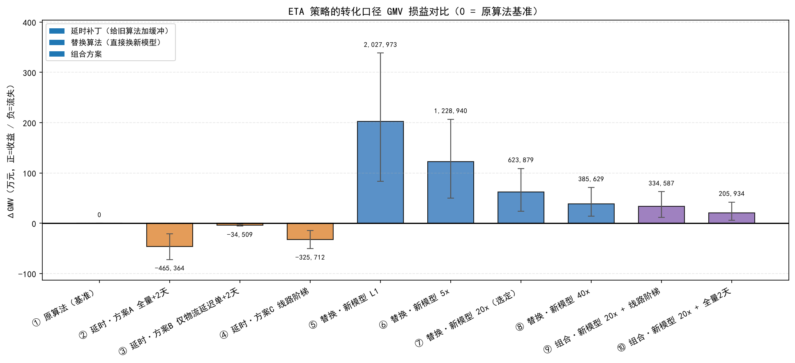
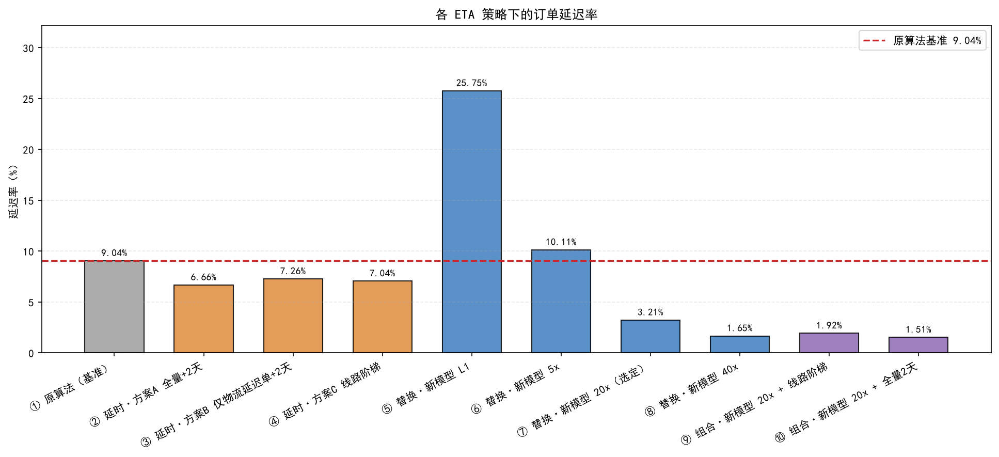
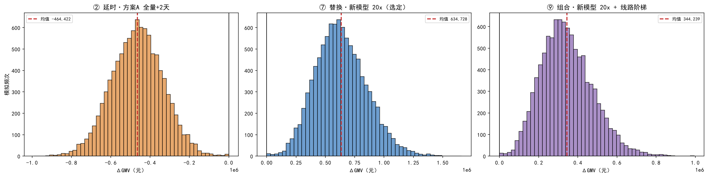
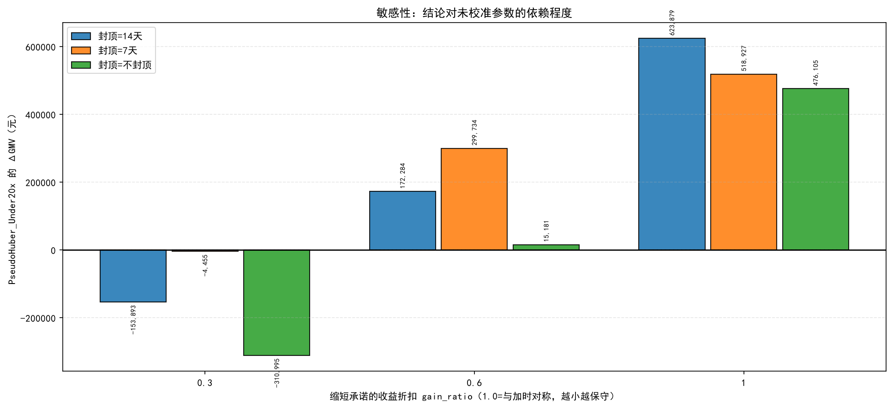

# ETA 策略的 GMV 统一账本

### 前言

前面的工作分两条线：一边在旧算法的承诺时长上做加法（ETA 动态延时策略，多给几天缓冲换少违约），另一边直接训练新 ETA 模型（LightGBM 非对称惩罚回归）替换原算法。两条路都能压低延迟率，但各有一套口径，谁更划算并没有放在同一本账上比过。本次把两者放进同一个 GMV 账本，统一以「客户看到的承诺天数」为输入，统一算转化损益、减少的延迟单与口碑收益，回答一句话：

> 同样是为了少违约，是给旧算法打补丁划算，还是直接换算法划算。

数据取自 2017 年 9 月至 2018 年 8 月共 72,907 单，同期 GMV 1,169.7 万元。原算法平均承诺 23.14 天，实际平均 12.72 天，基准延迟率 9.04%（6,589 单），物流归因超时单 4,820 单。

### 三条降低延迟率的路线

旧口径下的 ETA 延时策略是在原算法承诺上叠加缓冲天数，共三方案：全量 +2 天（全部 72,907 单承担流失）、仅物流延迟单 +2 天（4,820 单，需上帝视角）、按 (发货州, 收货州) 推荐天数加的线路阶梯（63,456 单）。三者共同点是在旧算法的过长承诺上继续加码——旧算法本就平均高估 10.4 天。本次复现的 GMV 流失与原报告逐项吻合（46.5 / 3.5 / 32.6 万，对应原报告 46.5 / 3.5 / 32.5 万），物流归因挽救率同为 26.89%，口径没有走样。

新路线方向正好相反：直接用新模型替换 ETA 来源，而原算法整体高估，因此换算法在多数订单上是在缩短承诺。这也决定了两者在 GMV 账本上的符号必然相反。本次把场景扩到 10 个一并比较：原算法基准、延时三方案、替换 L1/5x/20x/40x，以及两个组合（20x+线路阶梯、20x+全量2天）。

### 蒙特卡洛模拟方法

单次点估计只能给出一个数，无法回答结论有多稳，因此对全部场景各做 10,000 次模拟，每次同时扰动两类不确定性：单量波动（按 ±10% 比例对订单有放回抽样）与日流失率本身（外部文献值 1.8%/天，标准差 0.5%，抽样后截断为非负）。

关键换算在于等效天数。1.8%/天 锚定在平均时效的线路上，直接套用会失真——偏远 30 天线路加 2 天几乎无感，3 天的快线加 2 天却相当于时间翻倍。因此先把承诺变化折算到平均时效线路上：

$$
\Delta_{等效} = \Delta_{实际} \times \frac{T_{参考}}{T_{线路}}
$$

再代入边际递减的复利流失模型，按订单价格加权求和：

$$
\Delta GMV = \sum_i p_i \left[(1-r)^{\Delta_{等效,i}} - 1\right]
$$

其中 $r$ 为日流失率，$\Delta$ 为负（承诺缩短）时该式为正收益。本次新增两处保守化处理：一是等效天数封顶 14 天，因为新模型会把个别订单的承诺从 40 天砍到 10 天，复利模型外推到等效几十天会算出「单单转化 +200%」这类不可信的数；二是缩短收益折扣 $\lambda$，文献值只校准了「加时→流失」方向，反方向并无依据，故对缩短收益打折：

$$
\Delta_{等效}^{修正} = \begin{cases}
\Delta_{等效}, & \Delta_{等效} \ge 0 \\
\lambda \cdot \Delta_{等效}, & \Delta_{等效} < 0
\end{cases}
$$

主账本取 $\lambda = 1.0$（乐观对称），敏感性分析再取 0.6、0.3 检验结论是否翻转。

另有两点口径需要交代。延迟判定统一改用四舍五入到整天后比较，与 GMV 表的送达状态列 100% 吻合，此前模型评估用的连续口径与其相差约 0.4 个百分点，跨项目对账前必须先统一。口碑收益不与转化损益相减：延迟单 1 星率 47.15%、非延迟单 6.71%，1 星率差 40.45 个百分点，平均评分 2.41 vs 4.26，违约对口碑杀伤极大，但属品牌资产，单列为保护 GMV 与避免 1 星差评。

### 模拟结果呈现与对比

10 个场景的点估计与蒙特卡洛结果如下（转化口径，正=GMV 增加）：

| 场景 | 平均承诺 | 延迟率 | ΔGMV（万元） | 95% 区间 | 净减少延迟单 | 物流挽救率 |
|------|--------:|-------:|----------:|--------:|----------:|--------:|
| ① 原算法（基准） | 23.14 | 9.04% | 0 | — | 0 | — |
| ② 延时·方案A 全量+2天 | 25.14 | 6.66% | −46.5 | [−72.1, −20.8] | 1,732 | 26.89% |
| ③ 延时·方案B 仅物流单 | 23.28 | 7.26% | −3.4 | [−5.3, −1.5] | 1,296 | 26.89% |
| ④ 延时·方案C 线路阶梯 | 24.65 | 7.04% | −32.6 | [−50.6, −14.6] | 1,454 | 23.55% |
| ⑤ 替换·新模型 L1 | 13.61 | 25.75% | +202.8 | [+83.7, +338.3] | −12,185 | 26.80% |
| ⑥ 替换·新模型 5x | 17.35 | 10.11% | +122.9 | [+50.2, +206.8] | −783 | 57.26% |
| ⑦ 替换·新模型 20x | 20.51 | 3.21% | +62.4 | [+24.2, +109.1] | 4,248 | 82.18% |
| ⑧ 替换·新模型 40x | 21.85 | 1.65% | +38.6 | [+13.9, +71.2] | 5,385 | 89.88% |
| ⑨ 组合·20x + 线路阶梯 | 22.02 | 1.92% | +33.5 | [+11.8, +62.7] | 5,192 | 87.68% |
| ⑩ 组合·20x + 全量2天 | 22.51 | 1.51% | +20.6 | [+6.3, +42.1] | 5,485 | 88.67% |

图1 各 ETA 策略的转化口径 GMV 损益对比（0 = 原算法基准） 

图2 各 ETA 策略的延迟率对比 

结果呈现清晰的分野：三条延时方案全部为负收益，四条换算法路线全部为正收益，方向和上文预判一致。

延时方案的账很好算——每救回一单都要付出全线路或全订单的转化代价。最激进的方案 A 把延迟率从 9.04% 压到 6.66%，代价 46.5 万元（同期 GMV 的 3.98%）；即便最精细的方案 B 只给 4,820 单加时、救回 1,296 单，挽救率也只有 26.89%，仍付出 3.4 万元。

换算法是另一套逻辑，收益主要来自把过长的承诺砍回来，而非少违约。以选定的 20x 为例，平均承诺从 23.14 天降到 20.51 天，比原算法还短 2.63 天，同时延迟率降到 3.21%，净减少延迟单 4,248 单，物流归因挽救率 82.18%，转化口径 +62.4 万元（占同期 GMV 5.33%）；口碑侧另有保护 GMV 约 95.1 万元，避免约 1,718 个 1 星差评，两个方向同时获胜。

L1 的转化收益最高（+202.8 万）却是陷阱：它把承诺砍到 13.61 天，导致 14,116 单原本守约的订单被新承诺坑成违约，净减少延迟单为 −12,185，延迟率反而飙到 25.75%；5x 同理（−783）。真正可比的只有 20x 与 40x，二者净减少延迟单均为正（4,248 / 5,385），40x 延迟率更低但承诺更长，转化收益比 20x 少 23.8 万。

图3 蒙特卡洛 ΔGMV 分布（10,000 次：方案A / 新模型 20x / 20x+线路阶梯） 

蒙特卡洛给出了结论的可靠程度：三类延时方案的负收益概率均高达 99.96%，即无论单量与日流失率如何波动，亏钱几乎是确定的；四条换算法路线负收益概率为 0%。不过 20x 的 95% 区间跨度达 [24.2 万, 109.1 万]、标准差 21.9 万，收益的量级不确定，能确定的只是符号。

#### 稳健性：三个口径

上面的 3.21% 并不干净——新模型预测值里训练集区间的行是样本内的，模型见过这些订单的标签，延迟率会被系统性低估，因此必须同时给出三个口径：

| 口径 | 样本数 | 基准延迟率 | L1 | 5x | 20x | 40x |
|------|-------:|--------:|---:|---:|---:|---:|
| 全量（含样本内） | 72,907 | 9.04% | 25.75% | 10.11% | 3.21% | 1.65% |
| 时间外测试期（后 20%） | 14,582 | 5.89% | 11.10% | 4.13% | 1.95% | 1.55% |
| OOF 折外（5 折前向链） | 58,326 | 9.24% | 12.87% | 7.83% | 8.40% | 8.27% |

三个口径落差很大，只有折外口径（5 折前向链，模拟持续增量训练后预测新单）才接近真实部署：该口径下 20x 延迟率 8.40%，仅比基准 9.24% 低 0.84 个百分点，远不如全量口径显示的那么好看。不过折外口径下 20x 的转化收益仍有 72.7 万元（占期 GMV 7.8%），高于全量口径的 62.4 万——换 20x 的真实收益主要来自砍掉过长承诺的转化提升，延迟率在诚实口径下只是小幅好转。

折外表现的成因不在本账本重复分析，直接复用 运送预期算法优化 项目的结论（脚本 src/ooc_val.py，详见其 分析.md）：折外模型在 10~25 天这个占 41% 订单的主力区间比最终模型少承诺 3 天左右，延迟率因此从 1%~9% 抬到 9%~23%，而在 40 天以上的长尾区间又过度承诺（实际 78 天的订单给了 97 天）。根源是一年内真实配送均值从 16.96 天降到 7.74 天的分布漂移，前向链训练使模型的时效基准永远滞后于当下。换言之，折外表现不理想是校准滞后问题，不是长尾失控问题。

#### 敏感性：两个未校准参数

1.8%/天 是外部文献值，缩短收益是否对称也未经实测，因此这两个参数必须做敏感性检验：

图4 收益折扣与等效天数封顶的敏感性（以 20x 为例） 

| 收益折扣 λ | 封顶 14 天 | 封顶 7 天 | 不封顶 |
|----------:|--------:|--------:|------:|
| 1.0（对称） | +62.4 万 | +51.9 万 | +47.6 万 |
| 0.6 | +17.2 万 | +30.0 万 | +1.5 万 |
| 0.3 | −15.4 万 | −0.4 万 | −31.1 万 |

当缩短收益只认三成时，20x 就会转为亏损。反过来说，盈亏平衡给出的决策门槛是：20x 需要减时增益 ≥ 加时流失的 44%（封顶 14 天）/ 59%（不封顶）才能净赚，相比之下 L1 只要 6%、40x 要 61%。这是本次最需要实测验证的一个数字。

### 业务实操落地

综合以上结果，实操建议按三阶段推进。

第一阶段先校准，不要直接全量上线。上表已说明结论的符号稳健但量级依赖两个未校准参数，建议在低流量线路上做 A/B 实验，实测「每多承诺 1 天到底流失多少转化」，把 1.8%/天 换成平台自己的数，同时验证缩短承诺是否真能带来对称的转化提升；按方案 A 的口径，约 46 万元 GMV 就能换来一个可信的日流失率，成本可控。

第二阶段以 20x 替换原算法，不建议再叠加延时补丁。在 20x 之上叠加线路阶梯（场景⑨）或全量 +2 天（场景⑩），延迟率确实能继续降到 1.92%、1.51%，但转化收益从 62.4 万掉到 33.5 万、20.6 万——每多压 1 个百分点的延迟率，代价都在 20 万元以上。延时补丁是旧算法的产物，换了算法之后没有存在必要。

第三阶段监控指标以 OOF 口径为准。上线后若用全量口径监控会看到 3% 左右的延迟率，那是被样本内乐观污染的数字，建议把监控基线设在 8%~9%，并分线路看物流归因超时单的挽救率（当前 82.18%），它能更灵敏地反映模型是否真的在起作用。

两点边界需要提醒：L1 与 5x 转化收益最高，但会制造大量新增违约单，属净恶化，换算法的档位应选在 20x 与 40x 之间，不该被 L1 的漂亮数字误导；本账本只算了转化与口碑，未计入客服成本、退款与二次配送成本，也未考虑承诺缩短后订单量增长带来的履约压力，若平台端存在运力瓶颈需单独评估。

总体而言，换用 `PseudoHuber_Under20x` 是本框架下的支配方案：它比所有延时补丁都更省，且同时改善了承诺时长与延迟率。不过其主要收益来自转化提升而非延迟率改善，而这部分恰恰建立在未经实测的假设上，因此先做 A/B 校准、再谈上线，是当前最务实的路径。
