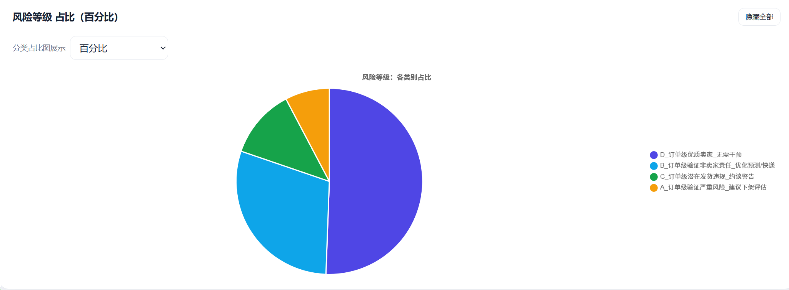
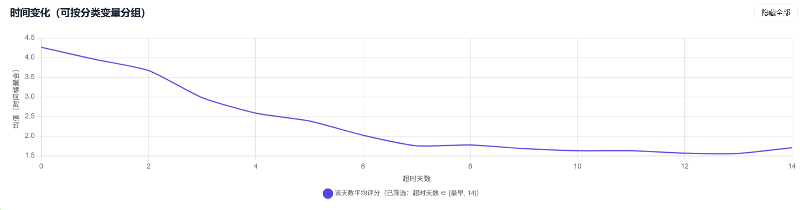
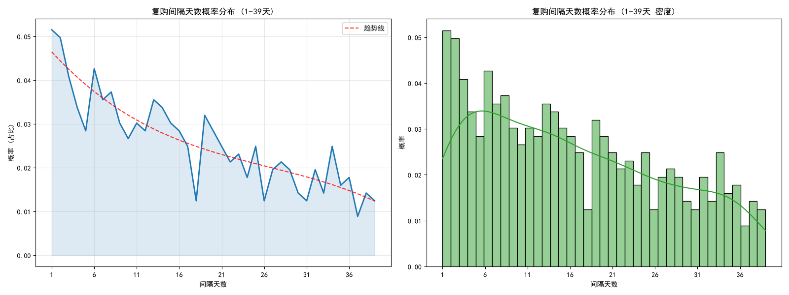
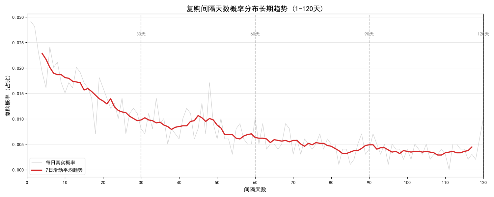
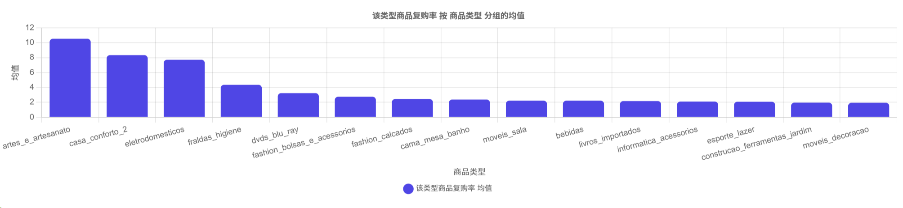

# 初级延迟率报告

## 总体概览

* 该报告基于筛选了订单状态为送达的部分，取了2017-09-01至今的所有数据。另外部分可能存在异常的部分样本已经删除，后续板块有详细说明。 
- 1.数据取近一年的所有订单，总体一共2589个商家，72164个订单，卖出73种商品，发货地涉及20个州，收货地涵盖27个州。
- 2.在近一年去除异常样本和未送达订单后，总体延迟率为 9.23%，订单评分总体平均为4.14，但是存在大部分满分默认评价，并且1星差评数量明显高于23星中评，1星差评是导致口碑恶化，用户流失的关键

## 统计显著性分析

- 1. 关于评分影响（有序逻辑回归）：买家“极度厌恶晚到”。数据显示，实际延迟时间对评分的负面杀伤力，是绝对运送周期的 2.4 倍（延迟天数每增加1天，高分概率下降11.5%，而总路程多1天仅下降5%）。
- 2. 关于超时与距离的关系（二分类逻辑回归）：物理距离与超时风险显著正相关。距离每增加 1000 公里，订单超时的几率将激增近 50%（OR=1.0004）。
- 3. 关于超时归因（卡方检验）：发货州、商品类型以及卖家个体能力均对最终是否超时存在极其显著的影响（p值均极小）。这说明超时不仅是路程问题，更是区域性物流基建、特定品类发货难度以及卖家履约水平共同作用的结果。

## 商家层面分析

- 1. 数据清洗与小样本剔除：存在大部分商家仅售出过极少数订单（可能是已关店或个体户交易），为排除极端噪声，本次商家层面指标筛选掉了售出订单小于 5 单的商家。
- 2. 核心评估逻辑升级（宏观比例 → 订单级微观归因）：传统的“超时率”和“超时占比”是基于商家大盘数据的宏观估算，容易产生“平均化假象”——即部分商家发货极其拖延，但碰巧被跑得快的快递兜底，从而在最终指标上伪装成优质卖家。为此，本次分析引入订单级微观归因，将每一笔订单精准拆解为“纯发货导致”、“纯物流导致”、“发货与物流共责”以及“发货延迟但未超时（潜在风险）”，从而实现对商家履约责任的精准定责。
- 3. 风险判定阈值设定（结合业务画像与数据分布评估）：
   · 签收超时率阈值：>10% 认为最终签收超时偏高；
   · 超时订单内发货因素占比阈值：>60% 代表最终超时的主因是商家发货慢；
   · 发货超时率阈值：>15% 代表卖家发货行为经常性超时；
   · 潜在风险率阈值：>10% 代表该商家有超过一成的订单存在“发货延迟（被物流救回）”的隐患。
- 4. 商家风险四象限分类与业务动作：
   · A类_实锤严重风险商家（签收超时高 & 发货因素占比高）：订单级归因实锤其为超时主因，需严肃处理，建议尽快责令整改，否则强制下架。
   · B类_被物流背锅商家（签收超时高 & 发货因素占比低）：订单级归因证实非卖家发货责任，建议优化对应线路的快递供应链或平台预测算法，豁免商家处罚。
   · C类_潜在发货违规商家（签收超时率低，但发货超时率>15% 或 潜在风险率>10%）：虽然当前最终超时不多，但底层隐藏了大量发货延迟的“雷”，作为风险商家，建议进行约谈警告，防止物流波动引发差评爆发。
   · D类_优质履约商家（各项指标均低）：订单级验证发货守时且最终履约良好，给予肯定和鼓励保持，可优先增加曝光度。

##  商品差异度分析

考虑到商品本身差异度，对商品自身种类分析也值得参考，本次主要以评分为指标，评估延迟送达在不同商品上是否有显著影响

- 1.部分例如急用日用品商品，对时间延迟敏感度非常高，延迟一小段时间可能直接使评分见底.
- 2.为了剔除长尾冷门商品噪声，筛选总订单≥5商品类型
- 3.取类似商家层面分析的分类标准，设定以下阈值：
    -优质评分标准 - > 4.2 
    -优质超时率标准 (%) -> 小于 8%
    -受严重影响评分标准 -> 4.0
    -高延迟超时率标准 (%) -> 大于 8.9%
- 4.按照以上标准，将商品分为四类：
    -优质商品，不易超时评分较高，可优先增加该类商品曝光
    -评分受超时影响最严重，可能是加急用品，安排发货和物流时需要优先处理
    -警惕商品，超时率高但评分为严重影响。可能是部分大件昂贵物品，此类商品需要着重加强监视评分动态变化
    -普通食品，表现正常，可正常处理。
    
    
## 发货州分析

由于实际上部分发货地过于偏远，导致距离过长而出现估测误差导致的超时，这些州需要着重申明运送时间会更长。

- MA拥有最高的超时率，达到接近24%，发货超时率也居高不下，其中发货超时占到了总超时单数的88.6%，需要严格审查该地所有销售商，并且评估该州仓库管理链是否存在混乱情况
- MS为小州，订单数很少，但是延迟率接近20%，需要评估平台算法。
- SP为毫无疑问的最大州，但是延迟率依然超过了均值，需要评估当地主流物流链的效率指定解决方案
- 对于部分偏远小州，无论发货还是收货地均需要申明预计送达时间将延长

 -以上所需要的数据与数据报告均存在相应名称的文件夹中-
 
 
## 延迟率与评分边际效应

通过时间序列图，本数据统计了所有订单在不同延迟时间的平均评分（时间单位聚合到1d，四舍五入）

- 在 未延迟送达时，平均均分在4.2 以上
- 延迟 1d，平均均分降到3.9左右，延迟2d降到3.6。此时下降趋势较为平缓
- 当延迟增加到3d时，评分下降趋势明显增加，3d评分只有2.9左右，并在3d以后，继续断崖式下降，并且大概延迟时间在7d及以后，均分收敛到1.5左右

此次分析表明，延迟率在2d以内尚可接受，一旦达到3d以上，1分差评数会暴涨。而考虑到现实中该均分还包含默认5星好评的部分，真实差评数会更加多，实际上推荐延迟时间不超过1d

 
## 2017-11月事件

在2017-11 月份，出现了平台首次极端爆单情况。尤其是在11 月 24 日出现了超级爆单，当日订单激增到1152单。

- 1.在11 月1日以前，单日订单稳定在100 -200 单上下
- 2.进入11 月份后，单日订单方差出现缩减，单日订单在150-200单上下，此时平均每单延迟时间已经出现了部分上升，表现出对于短期上升的订单数量，存在处理变化能力较低的问题，需要同时评估商家和发货链的管理
- 3.在11月20日 以后，迎来了首次大爆单时期。并且持续到了12 月 中旬。在此次大爆单的情况下，出现明显的平均延迟时长的峰值。对于类似这次的大爆单情况，可能是因为某些促销活动导致。在这种促销活动开始前，建议优化运送链，提醒商家整理仓库，并且适当延迟预计送达时间2-4天。

## 2018-02 - 2018-03

在2017 11月大爆单后，平台销售量出现了显著长期正向影响，持续到2018年年中，每日销售量都在180 - 300 间跳动，但是在大爆单时暴露出的问题，在大爆单结束后短期也出现了影响延迟率的情况

- 1.在爆单后存在短暂的下降期，持续到2018年年初开始回暖。此段时间延迟率均稳定在一定水平上，证明调整策略成功。
- 2.在2月-3月期间，延迟率突然又呈现了一个倒U型的趋势，一度平均每天每个订单都要延迟到4天以上，该段时间1分差评飙升至50以上
- 3.经对该期间单独数据分析后发现，该段时间内延迟归因在先前商家和物品划分等级下，非卖家发货超时导致超时的部分异常增高。相比总体32.3%占比，这段时间内非卖家发货超时的部分激增到58.2%，需要特别评估这段时间的快递供应商是否出现混乱情况，其次考虑预测算法是否需要优化。

## 对于时间算法

查询相关文献，大部分都表示树模型在类似地方会优于深度学习网络。本数据部推荐构造特征工程+LightGBM，训练不同分位数模型：
-推荐构造的特征：
    -距离分段与阈值标志
    -发货地/收货州
    -商品类型
    -长尾 卖家标志
    -促销活动 标志
    -近7日订单量偏移度
    -OD 对 历史延迟均值
注意此处分位数校准度和不同承诺策略下的准时命中率，推荐以P50/P90/P95训练。

此外，当上述方法遇到瓶颈时，引入多任务LightGBMH混合结构：
-建议 同时优化回归损失和辅助2分类（是否延迟>=3天），利用分类任务的监督信号强化模型对风险的敏感度

同时建议 参考DGM-DTE思路：
-对快慢分类，然后对慢速子集单独建模或加权

在建立模型时，推荐使用蒙特卡洛模拟验证，将分位数输出拟合为偏态分布，如对数正态分布，通过蒙特卡洛抽样得到完整送达时间概率密度函数。并且分布形态需要按发货周或商品分层拟合，各区域尾部厚度差异很大

## 补充数据发现

该数据存在部分缺失和异常，可能映射为系统算法bug或者是信息缺失，具体表现为：

- 1.部分客户实际送达时间缺失，可能是用户始终未签收或者是系统统计bug
- 2.部分商家实际发货时间缺失，可能是商家未填写或者系统bug，建议核实
- 3.存在审核时间缺失，可能是系统bug
- 4.商家和客户均有部分邮编编码在数据库中无法找到对应实际位置，若不是保密需求，可能存在统计不全
- 5.存在部分审核时间均晚于实际发货和预估最晚发货时间，可能是审核系统有bug
- 6.存在部分实际发货时间晚于实际送达时间，需要评估系统问题

同时建议优化审核系统，将其确定后同步优化预估时间。存在以上异常的样本已经直接去除。

# 对于延迟率补充说明

- 1.72907为选定为近一年，从2017-9-1至今的已送达数据，若存在以上补充数据发现中的异常样本已去除，近一年总体延迟率为9.41%
- 2.本轮优化了相较于之前的统计口径，构造了超时原因特征变量，在全局72907每个订单都以以下标准划分每个单独订单评估， 将订单拆解为了“纯发货导致”，“纯运输导致”，“发货和运输共同导致”，“发货延迟但未超时”，“未超时”的四种，其占比分别约为“1.0%”，“6.9%”，“1.5”,“6.6%”，“84.0%”： 
   - 签收超时率阈值(最终送达超时)：>10% 认为最终签收超时偏高；
   - 超时订单内发货因素占比阈值：>60% 代表最终超时的主因是商家发货慢；
   - 发货超时率阈值：>15% 代表卖家发货行为经常性超时；
   - 潜在风险率阈值：>10% 代表该商家有超过一成的订单存在“发货延迟（被物流救回）”的隐患。
- 3.按照每个商家对于每一种订单数量的占比，将商家分为了：
   - A类_实锤严重风险商家（签收超时高 & 发货因素占比高）：订单级归因实锤其为超时主因，需严肃处理，建议尽快责令整改，否则强制下架。
   - B类_被物流背锅商家（签收超时高 & 发货因素占比低）：订单级归因证实非卖家发货责任，建议优化对应线路的快递供应链或平台预测算法，豁免商家处罚。
   - C类_潜在发货违规商家（签收超时率低，但发货超时率>15% 或 潜在风险率>10%）：虽然当前最终超时不多，但底层隐藏了大量发货延迟的“雷”，作为风险商家，建议进行约谈警告，防止物流波动引发差评爆发。
   - D类_优质履约商家（各项指标均低）：订单级验证发货守时且最终履约良好，给予肯定和鼓励保持，可优先增加曝光度。

图1 订单分类饼状图

    
 此处口径没有使用商家分位数来划分阈值，而是使用对于实际业务的期望来划分。我们希望总延迟率容忍度为10%，
商家在超时订单中延迟发货占比容忍度为50%，商家总发货延迟率容忍度为15%，
 商家延迟发货却因物流救回了延迟率的订单占比容忍度为10%。
 此数据可根据对平台的期望来调整，
 调整过低可能会导致大量不合格商家出现，脱离实际，而过高会导致无效调整。此处数据基于经验选择的折中值。
最后对于四类商家，优质商家，物流原因主导商家，发货违规风险商家，自身原因高风险商家占比约为 50.6%,29.7%,12.0%,7.7%

图2 商家分类饼状图

在分完组后，对四类商家的均分进行评估，数值为4.306，4,4.132,3.752。由于风险卖家被物流挽救，实际最终超时订单并不多，评分也居于第二，但是需要尤其警示，在物流不稳定情况下，这类商家很可能成为新的最高风险商家。
同时观察分组后超时率均值，最高风险卖家居高不下，达到22%以上超时率，相对应因物流延迟导致延时商家的延时率均值为17.6%，建议立刻对最高风险卖家采取措施，立刻对非卖家责任部分物流或者算法进行制定策略。
相关支撑数据均放在了对应文件夹中。发货时长对比物流时长在商家层面放在商家延迟率与订单级归因表.csv里，而总订单对比放在了订单时间段分析清洗后.csv中

- 再度优化了一下延迟天数和评分的模型，原先使用线性逻辑回归未通过假设检验，此次更换为了部分优势比模型。为保证部分长尾数据，例如上百天延迟却因买家未评价而默认五星的数据干扰，本次去除了超过三十天延期的部分。
拟合结果表明：
    - 实际最终延迟时间:1（跌至 1 分的几率） = 1.355：
  延迟每增加 1 天，买家直接给 1 分（极度愤怒）的概率暴增 35.5%！
    - 实际最终延迟时间:2（跌至 2 分及以下的几率） = 1.297：
  延迟每增加 1 天，评分跌入 1-2 分（差评区）的概率增加 29.7%。
    - 实际最终延迟时间:3（跌至 3 分及以下的几率） = 1.172：
  延迟每增加 1 天，评分跌入 1-3 分（中差评区）的概率增加 17.2%。
   - 实际最终延迟时间:4（跌至 4 分及以下的几率） = 1.053：
  延迟每增加 1 天，评分未能保持 5 分满分的概率增加 5.3%。

图3 评分与延迟天数曲线图

### 在做GMV A/B实验之前，有必要先摸清客户的情景，以及复购率问题的思考。

# 复购率痛点初步分析

对商品分类进行多角度分析，首先需要申明，有605个product_id没有找到对应的商品类型，并缺少相应商品描述信息，可能是系统录入问题。通过统计学检验表明，商品送达状态和商品是否信息完整没有显著联系。
并且在分析不同商品类型的订单达成率来看，未分类的商品明显具有更低的订单完成率，平台需要着重注意。猜测可能是小微个体商户或者私下二手交易情况，需要正规化。

先说一个残酷的事实：很遗憾近一年数据中表明仅有2.7%的用户买了两单及以上，0.5%的用户买了三单及以上。
证明实际上基本所有客户都是单次购买后便流失。另外我们又纵观数据创立以来所有客户，在2017-9-1日以前下过单，但是在2017-9-1后至今
都没有再下过单的用户占到了所有有过购买记录的用户的23%。但是我们依旧还是对这些存在复购行为的极少数用户进行了分析。分析使用多种
方法避免样本噪声和幸存者偏差的影响，但由于本身占比过小，只能获得参考性的统计检验结论。

- 对近一年的客户订单的全面统计检验分析，只有超时率这一个因素显著影响了客户是否复购，你提到的首单品类，客单价等等因素都在统计学上不显著。
- 对于仅下单一次和下单两次及以上的客户在超时率上的分布有显著的区别，一次性卖家的超时率分布与复购客户有显著区别。数据中虽然显示购买三次及以上的买家具有显著更低的超时率，
但由于极低的样本数量和噪声拉大了均值差距，所以以实际统计检验结果为准。
- 对历史所有用户首单数据分析后，流失用户，即2017-9-1日后不再购买商品的用户与购买过商品的用户间具有显著差异。流失用户首单评分显著更低，证实了首单订单对于客户的留存率的重要性之大。
- 首单的评价虽然与客户是否流失有显著关系，但是量化该关系十分困难。本身未复购的用户占了极大比例，模型最终基本预测能力和随机猜差不多。
- 此处再基于存在复购的客户进行复购率分析，时间尺度约为30天，总体呈现缓降趋势。分别在第6天，14天，20天左右引来局部高峰，这迎合了人们喜欢在周末购物的习惯。

图4 商品类型与回购率关系

- 将时间周期拉长到第120天，构造7日滑动平均趋势部分，我们可以观察到
  - 整体趋势在前30天平缓下降。
  - 大约在40-50天这个窗口，复购率有明显的反弹趋势。在大约46-48天达到顶峰，随后在60天左右恢复到较低水平
  - 在60天以后，趋势一直处于较为平稳的低水平，仅在90天有部分小反弹。

图5 商品类型与回购率关系

 
以上结果对于业务决策有较大启发。平台可在周末，人们购物喜好时期发放回馈优惠券，折扣活动来吸引顾客回购。若客户在长时间未回购，尝试在40天左右使用较大额度的折扣或者营销活动来吸引
曾经老顾客的回坑。

另外，在商品层面的分析也值得考商。部分快消品商品回购率会明显比电子设备这样的耐用品回购率高。

图6 商品类型与回购率关系

总体复购率在1.22%左右，中位数为0.71%，证明回购率具有长尾性质。图中呈现了前15回购率的商品信息，前三中商品回购率明显属于第一梯度，第四第五大概稍微高出后面上游梯队，此后大概收敛到2%左右的回购率

即使复购率惨淡，传统GMV和生命模型很难精准识别客户阶层。但我们可以放弃传统的GMV，不需要紧盯着复购率该部分进行客户识别。例如一个客户复购订单数虽然少，但是一来就是大单，我们可以将每单平均价格纳入分组意识，对这些客户需要着重关照保证利益。

| 客单分层 | 平均超时率 | 平均评分 | 客户数 |
| :--- | :--- | :--- | :--- |
| 低客单 (<100) | 8.75% | 4.10 | 42,633 |
| 中客单 (100-500) | 9.63% | 3.99 | 28,263 |
| 高客单 (>500) | 10.05% | 3.84 | 2,726 |

以上基于一年内所有客户平均每单价格来划分，得出以下结论:
- 随着订单价格增加，超时率不降反升，平均评分也在下降
- 意味着平台实际上高净值客户，反而遭受了更差的送达预期，给的评价也偏低

出现以上情况可能是由于:
- 一般的高价值商品可能都是大件，备货周期长，对快递要求高，极易在备货和运送期间卡壳
- 部分高价值商品可能需要物流专线，会比普通商品有更多的物流节点从而拖累了时间

建议平台以后采取以下措施：
- 对于高额订单进行特殊干预，在高额订单上只允许优质商家发货，对商家要求要求更严格。
- 优化高额订单算法，人为增加预计缓冲期
- 检测到高额订单延迟发货时，立刻启动客户干预，采取安抚手段。

另外，数据表中列出了高客单用户，建议采取特殊关照手段保留这些客户。

### 总结复购痛点

 核心结论：一次性买家主导大盘，首单体验定生死

当前平台复购率极低（2次及以上仅 2.7%），绝大多数客户买完即走。数据证明，首单物流体验（超时率）和首单评分是决定客户留存/流失的唯一显著因素，而首单品类、客单价等非体验指标无法预测复购。由于基数极度悬殊，传统的“复购预测模型”失效。

关键业务发现

1. 首单差评 = 永久流失：流失用户的首单评分和超时率显著劣于留存用户，证明“首单砸了，用户连骂都不骂，直接卸载”。
2. 复购存在黄金时间窗：短期在第6、14、20天（周末节点）有复购小高峰；长期在第40-50天会出现明显的“冷静期后的回坑反弹”。
3. 高净值客户体验严重倒挂：高客单（>500）客户的超时率最高（10.05%），评分最低（3.84）。高价值商品（大件/备货难）的履约瑕疵，正在逼走平台最赚钱的客户。

落地行动建议

- 死保首单体验（防流失）：放弃不切实际的“全量复购唤醒”，集中营销和客服资源，确保首单（特别是高客单）的准时送达与超时安抚。
- 掐点精准营销（促唤醒）：在客户购买后的周末节点发放小额折扣；针对沉寂用户，在第 40天左右 触发大额“老客回坑券”。
- 启动高客单护航计划：导出高客单用户名单（已导出），针对高额订单强制绑定优质商家与物流，人为拉长预测 ETA 缓冲期，建立延迟自动安抚机制。放弃传统 RFM，用“客单价”作为客户分层的核心标尺。

### 开始分析延后预期送达时间是否能使用短期的转化损失来换取不确定的长期评分保护

部分研究有表明，若提前送达可能也会导致买家评分下降（打乱原本计划）。在本次数据中，大部分订单都是提前送达，并且通过统计检验发现并没有显示出较为严重的提前送达惩罚，只有延迟送达带来的评分灾难级下降。说明
在大部分客户眼中只在乎会不会延时送达，所以不必为了提前送达而去改变，带来的边际效益是递减的。

### ETA 动态延时策略：三大方案对比与选型建议

在跑通蒙特卡洛模拟前，我们锁定了核心计算口径（ETA生效层级、复利式流失模型、纯净的物流归因、双轨制分母），确保推演结果真实可落地。以下是三套方案的最终对比：

#### 核心业务账本

| 方案 | ETA生效口径 | 计入成本(承担流失) | 挽救物流延误单 | 挽回率 | 预期1星差评减少 | GMV流失(成本) | 单救成本 |
| :--- | :--- | :--- | :--- | :--- | :--- | :--- | :--- |
| A: 全量+2天 (实验组) | 线路级 | 72,907 单 | 1,296 | 26.89% | 524 个 | 46.45 万 | 358 元 |
| B: 仅物流单+2天 (最优解) | 订单级 | 4,820 单 | 1,296 | 26.89% | 524 个 | 3.49 万 | 27 元 |
| C: 阶梯延时 (妥协解) | 线路级 | 63,456 单 | 1,139 | 23.63% | 461 个 | 32.53 万 | 286 元 |

#### 三大方案定位与选型结论

1. 方案 A（全量+2天）：仅作校准实验，绝不长期执行
- 痛点：效果与 B 完全一样，但让全量订单承担流失，成本是 B 的 13.3 倍。
- 价值：作为 A/B 实验组。只需花 3,593 元（14天×20%流量），就能把文献里的“1.8%单日流失率”替换成平台真实值，夯实整个模型的地基。

2. 方案 B（订单级 ETA）：理想最优解（强依赖产品能力）
- 优势：精准打击，单救成本仅 27 元，效率极高。
- 前提：产品端必须支持“订单级差异化 ETA”（只给会延误的订单加时）。如果技术做不到，此方案不成立。

3. 方案 C（线路级阶梯）：现实妥协解（预算导向）
- 业务矛盾：算纯经济账，救一单要花 286 元（订单均价才 160 元），但在线路级 ETA 下，这是唯一能挽回口碑的抓手（每个差评成本 706 元）。
- 落地机制：采用“边际贪心”算法，按“单救成本”从低到高买入，预算封顶。30 万预算可换取 23.63% 的挽救率。

#### 业务落地建议

1. 第一步：立刻启动方案 A 的小流量 A/B 实验（花 3 千多块钱），校准出平台真实的转化流失率。
2. 第二步：如果产研能开发订单级 ETA 能力，直接全量上方案 B，闭眼入。
3. 第三步：如果系统只能做线路级 ETA，选择方案 C。建议先用 10-15 万预算试水（挽救率 10-14%，单救成本 167 元），验证有效后再逐步追加预算。

账本中的“保护 GMV”为体验口碑价值，不可直接与流失 GMV 相减得出净利润；挽救率是预算的单调函数，预算越高，边际单救成本越贵。

### 注：

商家清退这块，建议先约谈警告，不要直接下架——每换掉一个商家都会带来一大笔供应链调整成本。先评估高延迟发货率商家的实际行为，套用上面的优化方案观察一段时期，看整改效果再决定是否动刀。

## 后续工作

由于种种交叉因素，ETA的预测是复杂的。我们并不能使用简单的基于表面延迟数据，机械增加预期天数来长期挽救延迟率，这只是短期紧急救急策略。在往后我们将单独从历史订单的角度，分析原算法并设计全新ETA算法。
