# 优化快递运送时间预测算法

### 前言

首先有必要了解总体送达时间偏差的分布。总体来看总体平均提前送达10.42天，并且数据存在严重厚尾，极端值数量远大于正态分布预期。

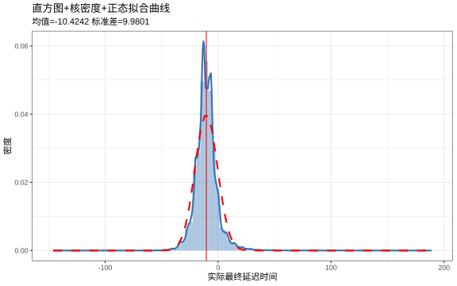

图1 

我们可以看到，总体算法预测能力较弱，过于保守的运送时间估计导致系统严重高估大部分订单的送货时间。另外厚尾分布也说明，存在部分订单存在极端情况，同时也表明了物流的不稳定性，可能遇上极端天气或者极端情况。

首先评估先前根据不同路线对应指定的天数延迟测率，将其应用到历史路线订单上，并与原先分布进行对比
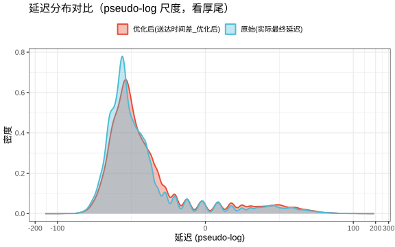

图2 

分组统计了原始与优化后两组延迟样本的均值、分位数、峰度、极值以及高分位样本贡献占比，对比可见优化后峰度小幅下降，但P99、P999、最大值仍处于相近水平，尾部极端值的贡献占比反而略有上升，厚尾特征没有明显改善,考虑到上一版方案对延长预期方案没有实际流失率数据（需要做A/B实验），延迟天数修订方案保守。

设计新算法的业务目标是尽量使得预测时间准确，波动小，并且严格控制延迟送达的情况。先对原始快递送达周期分布进行分析

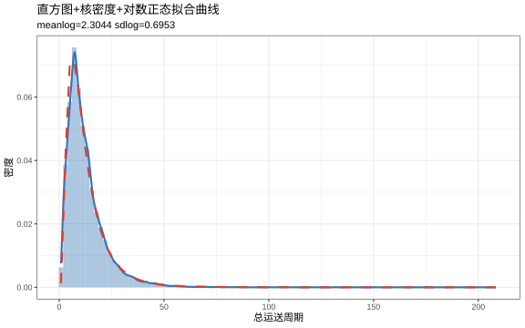

图3  

可见快递运送总周期（含发货时间）总体符合对数正态分布，在此类分布上，广义线性模型和树模型是值得尝试的选项。

## 回归模型建立

### 设计目标变量

由于传统回归模型一般最终会让残差随机散布在两边，这样会导致超时订单期望达到50%。我们希望在最最小化超时订单的约束下，让预测值尽量贴近真实值。设定非对称的惩罚函数是一个值得考虑到的方向。
首次实验使用分层自构Huber损失函数作为优化目标，设定对超时订单不同惩罚倍率，来尽量压低超时率。
- 低估天数
$$
d_i = \max(y_i - \hat{y}_i, 0) 
$$
- 高估天数
$$
u_i = \max(\hat{y}_i - y_i, 0)
$$
- Huber
$$
H_\delta(x) = \begin{cases} 
\frac{1}{2}x^2, & x \le \delta \\
\delta(x - \frac{1}{2}\delta), & x > \delta 
\end{cases}
$$
- 总损失函数
$$
L_i = \lambda_l H_\delta(d_i) + \lambda_h H_\delta(u_i) 
$$

### 分层建模思想

相关研究表明，没有单一模型能同时精通常规级订单和阶段场景。而现实往往充满不确定性，存在极端离群值，例如洲际运送，极端天气，购物热潮等等。传统回归统计思想中，这类数据往往会被归为噪声而被消除，而现实这种情况是真实存在的。在原数据大部分变量都存在长尾数据，需要保证常规数据的处理情况下，对这些长尾数据进行关照。

其中常见处理的一种方法就是分为两阶段，第一阶段对部分长尾订单进行分类，例如是否归到国际订单，或者是否存在大促时期。
第二阶段变就是建立多个分层模型，并让分类器决定订单走哪个模型。另外，有成熟的工业ETA采用模型预估结果+长尾规则补时的组合策略，给极端场景确定了一个“安全垫”。首先先尝试构造特征变量建立单层模型作为基准线模型，该过程难点在于如何精准通过业务识别构造特征变量，以及模型之间的取舍如何选择。

#### 特征变量

首先构造特征工程，由于部分如质量，距离等数据存在长尾特性，对具有这些性质的变量进行log1p对数变化平滑。再对于商家，平台订单数等等部分构造滑动窗口，衡量一段时间内平台订单和商家压力。另外构造了购物高潮时期，通过历史时间序列分析，在11月至12月黑色星期五出现了购物高潮，特别在11月24日黑色星期五当天出现了极端高峰订单,对黑色星期五当天直接单独建立一个特征变量，再为黑色星期五当周，近月都单独构造特征变量。

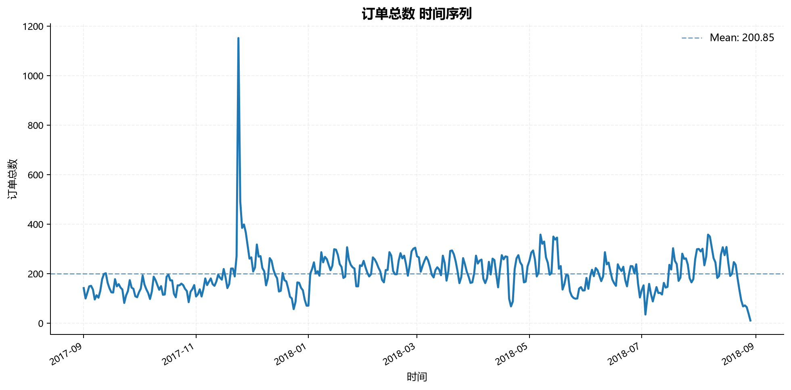

图4  

另外还使用分位数区分了是否为超远运输，是否为超重运输等等。大件运输判断标准使用99分位数，从体积或者重量两个方面判断是否为大件，任意一满足归为大件运输。按 (发货州, 收货州) 分组算路线历史 P90 与超时率，并用贝叶斯平滑（m=10）向全网先验收缩，解决冷门路线样本少的问题；最后派生出偏远州、国际订单两个 0/1 标签。

| 类别 | 主要变量 |
|------|----------|
| **数值变换** | 对数质量、对数体积、对数价格、对数运费、对数距离、对数运送周期 |
| **比率派生** | 运费占比、单位距离运费 |
| **时间日历** | 星期_周一始、是否周末、是否黑五月份、是否黑五当天、是否黑五当周 |
| **平台滑动** | 平台_7天单量、平台_7天平均审核时长 |
| **卖家滑动** | 卖家_7天单量、卖家_7天平均发货时长、卖家_7天超时率 |
| **卖家动态** | 卖家_前7天单量、卖家_单量增幅、卖家_历史最高7天单量、卖家_产能负荷率 |
| **路线历史（平滑）** | 路线P90_总历史、路线超时率_总历史、路线P90_近期90天、路线超时率_近期90天 |
| **标签/类别** | 是否为大件、是否为偏远州、是否为国际订单 |
| **类别特征** | 发货城市/收货城市（已做音标清除+小写+去符号清洗）、发货州、收货州、seller_id 等 |

#### LightGBM模型建立

本次使用LightGBM作为基准树模型，并且对比使用Huber非对称惩罚超时订单，倍数为超时订单惩罚对于提前订单惩罚，同时尝试5x、20x、40x三档倍率的回归情况。全部订单取2017年9月1日及以后，2017年8月数据仅用于初期构造滑动窗口等特征工程，不进入模型。模型使用二八分测试集和训练集，训练集结果如下：

| 模型                   | MAE（天） | 提前送达率   | 延迟率     | 严重超时率  |
| -------------------- | ------ | ------- | ------- | ------ |
| L1                   | 3.392  | 82.814% | 17.186% | 1.639% |
| PseudoHuber_Under5x  | 5.651  | 93.903% | 6.097%  | 0.727% |
| PseudoHuber_Under20x | 8.075  | 97.277% | 2.723%  | 0.391% |
| PseudoHuber_Under40x | 9.353  | 97.840% | 2.160%  | 0.350% |
| 原算法                  | 10.890 | 93.485% | 6.501%  | 1.221% |

从结果看，L1 模型的整体预测精度最高，MAE 为 3.392 天，远优于原算法的 10.890 天。但其延迟率为 17.186%，是所有模型中最高的。考虑到实际业务对延迟应当惩罚最大，这个模型应当舍弃。

随着 Pseudo-Huber 模型的非对称惩罚增强，延迟率从 6.097% 逐步降至 2.160%，严重超时率也从 0.727% 降至 0.350%，但 MAE 随之上升。这体现了预测精度与降低延迟风险之间的权衡。若更重视配送承诺的可靠性，`PseudoHuber_Under5x` 或 `PseudoHuber_Under20x` 值得进一步考虑。若希望延迟率尽量低，`PseudoHuber_Under40x`可牺牲部分准时预测，将延迟率进一步压缩到更低水平。

总体而言，原算法预测时长均值为 18.712 天，远高于真实均值 8.413 天，存在明显的整体高估。新模型显著改善了预测表现，但最终选型应结合业务对误差和延迟风险的容忍程度，而不能只追求单一指标最优。

以上对比算法是基于模型直出的连续数据。但是由于原算法的预计送达时间是取整的，对于总周期的计算方式与直出数据不匹配。为了消除这个问题，我们采用将直出的周期加到下单时间算出的时间，向后取整，例如2018-9-1 13:45:30 ，取到2018-9-2 00:00:00，然后再反过来修正不同算法的总运送周期。这样匹配了原来的总运送周期的算法，从而使数据间有可比性。以下展示在修正后的数据在训练集以及验证集的结果：

| 模型                   | MAE（天） | 提前送达率   | 延迟率     | 严重超时率  |
| -------------------- | ------ | ------- | ------- | ------ |
| L1                   | 3.743  | 87.519% | 12.399% | 1.372% |
| PseudoHuber_Under5x  | 6.097  | 95.412% | 4.581%  | 0.672% |
| PseudoHuber_Under20x | 8.554  | 97.888% | 2.105%  | 0.370% |
| PseudoHuber_Under40x | 9.834  | 98.306% | 1.687%  | 0.322% |
| 原算法                  | 10.890 | 93.485% | 6.501%  | 1.221% |

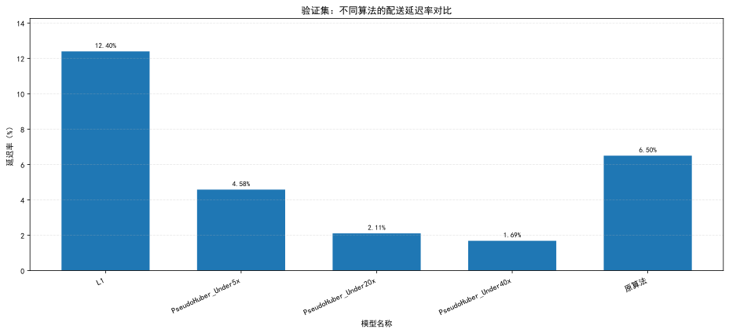

图5 验证集延迟率对比 

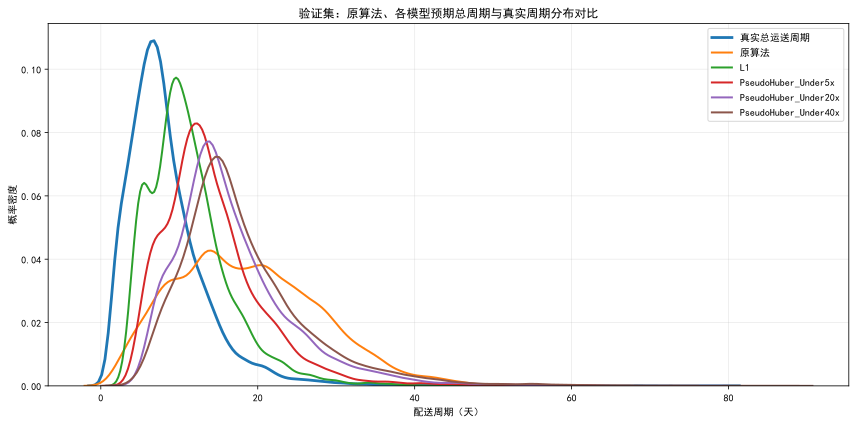

图6 不同算法预测周期分布图 

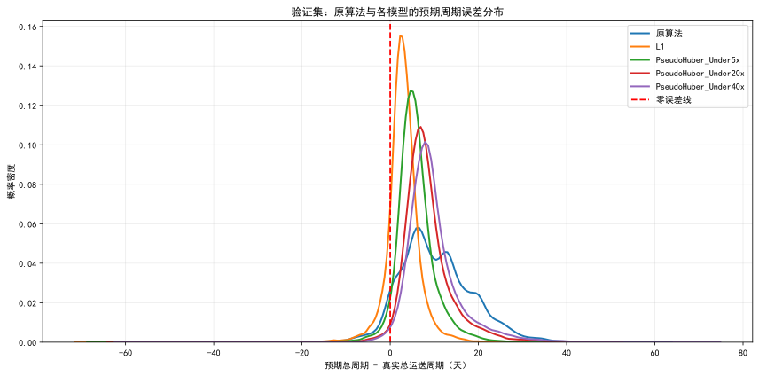

图7 不同算法预测误差分布图 

结果表示，在验证集上，除 L1 外的三个非对称惩罚模型延迟率都低于原算法的 6.501%，其中 40x 进一步压到 1.687%，下面展示在完整数据上的模型能力：

| 模型                   | MAE（天） | 提前送达率   | 延迟率     | 严重超时率  |
| -------------------- | ------ | ------- | ------- | ------ |
| L1                   | 4.002  | 72.709% | 27.209% | 6.652%  |
| PseudoHuber_Under5x  | 5.713  | 89.052% | 10.904% | 1.867%  |
| PseudoHuber_Under20x | 8.136  | 96.434% | 3.547%  | 0.513%  |
| PseudoHuber_Under40x | 9.313  | 98.137% | 1.845%  | 0.251%  |
| 原算法                  | 12.140 | 90.570% | 9.409%  | 4.017%  |

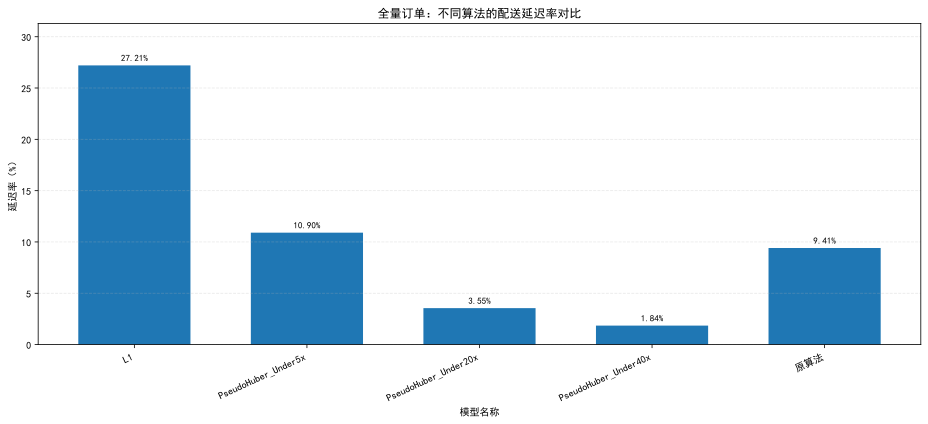

图8 延迟率对比 

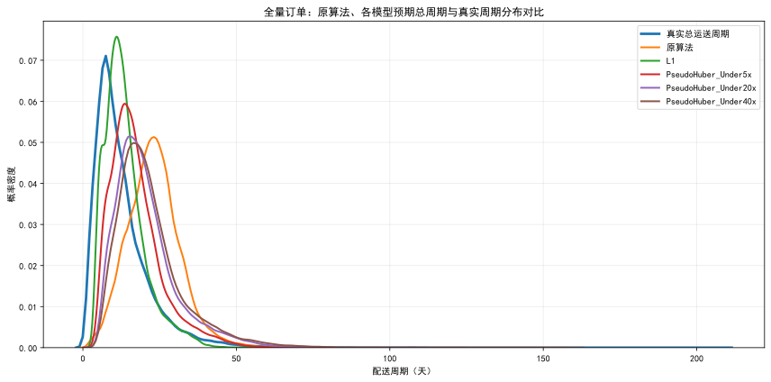

图9 不同算法预测周期分布图 

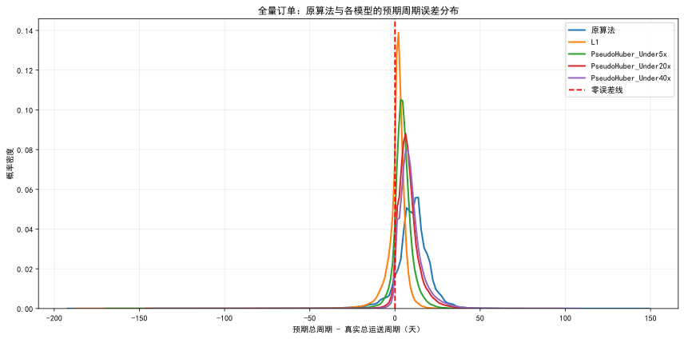

图10 不同算法预测误差分布图 

在完整数据上，部分模型呈现了与验证集不同的特性，在原L1和惩罚较小的模型上出现了超时率反弹的情况，L1 延迟率反弹到 27.209%，5x 也达到 10.904%，均高于原算法的 9.409%。不过结合对于先前卖家分层后采取不同敦促和手段压低卖家违规发货时间，延迟风险可有部分改观，但是这仍然是风险选项，不建议开局便采用。为了将延迟率风险最小化，建议初期采用更加保险的策略。

不过选择更保守的算法意味着预期送达时间会总体增加，需要之前设计的A/B实验结论来判断预期天数的增加对于客户流失的实验结论来判断。不过即使是最保守的新模型，延迟率在极低的情况下，其预测的精度以及稳定性都要远远大于原来的算法。可以先采用相对保守的`PseudoHuber_Under20x`替换原算法。

#### TransformerCNN模型建立

前面用 LightGBM 建模，时序信息是靠人工构造的滑动窗口和路线历史特征间接喂进去的，窗口一旦定长，更长时间的依赖就不好表达。这里额外搭一组深度学习的对照模型，看看换一种方式能不能做得更好。具体是用 Transformer 编码器读下单前的历史时间片快照，靠自注意力去抓长时序依赖；再加一条多尺度的一维卷积分支（VCN，卷积核取 3、5、7），在同样这段序列上滑动，提取近几个时间片的局部突变。两路结果拼上当期订单的静态特征，输出对数的配送周期。历史序列只取下单前已经结束的时间桶，不含下单当期，避免用到未来的信息。损失口径、对数还原、00:00 取整规则都和 LightGBM 保持一致，倍率同样取 L1、5x、20x、40x 四档，按时间二八切分，全部订单取 2017 年 9 月 1 日及以后。模型直出的连续数据结果如下：

| 模型 | MAE（天） | 提前送达率 | 延迟率 | 严重超时率 |
| ---- | ------ | ------- | ------ | ------- |
| L1 | 3.855 | 83.919% | 16.081% | 1.694% |
| PseudoHuber_Under5x | 6.735 | 95.220% | 4.780% | 0.713% |
| PseudoHuber_Under20x | 10.008 | 98.080% | 1.920% | 0.363% |
| PseudoHuber_Under40x | 9.958 | 97.799% | 2.201% | 0.405% |
| 原算法 | 10.890 | 93.485% | 6.501% | 1.221% |

从结果看，L1 的整体预测精度最高，MAE 为 3.855 天，比原算法的 10.890 天好很多，但它的延迟率高达 16.081%，是所有模型里最高的，这个模型同样不适合直接用。随着非对称惩罚增强，延迟率往下走，但 20x 和 40x 之间出现了倒挂：40x 的 MAE（9.958）反而比 20x（10.008）低，延迟率却略高一点。这和 LightGBM 上「倍率越大、延迟率越低」的平滑变化不一样，说明深度模型在很高倍率下不够稳定，倍率和延迟率不是严格单调的，选型时要留意这一点。

取整到 00:00 后，验证集结果如下：

| 模型 | MAE（天） | 提前送达率 | 延迟率 | 严重超时率 |
| ---- | ------ | ------- | ------ | ------- |
| L1 | 4.218 | 88.273% | 11.658% | 1.468% |
| PseudoHuber_Under5x | 7.193 | 96.331% | 3.655% | 0.617% |
| PseudoHuber_Under20x | 10.487 | 98.430% | 1.570% | 0.322% |
| PseudoHuber_Under40x | 10.443 | 98.231% | 1.769% | 0.377% |
| 原算法 | 10.890 | 93.485% | 6.501% | 1.221% |

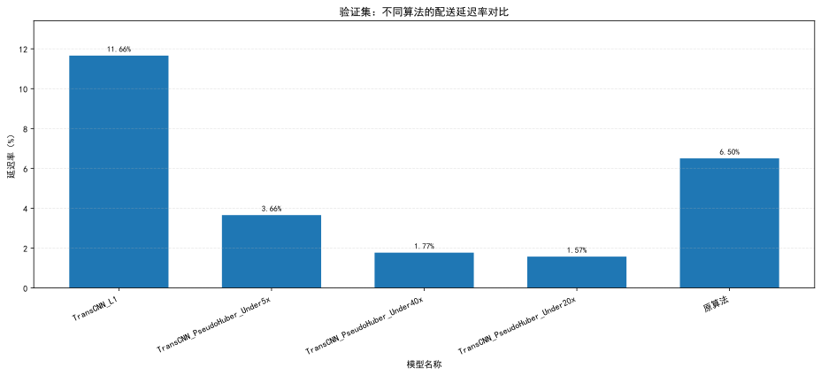

图11 TransformerCNN 验证集：延迟率对比 

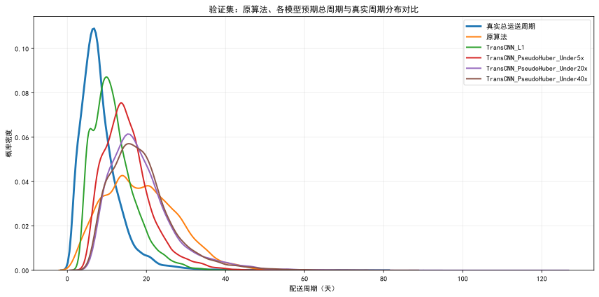

图12 TransformerCNN 验证集：不同算法预测周期分布图 

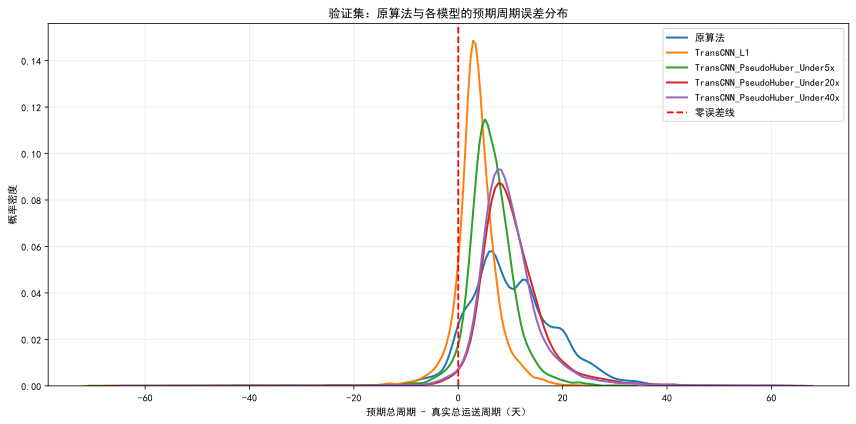

图13 TransformerCNN 验证集：不同算法预测误差分布图 

结果表示，在验证集上，除 L1 外的三个非对称惩罚模型延迟率都低于原算法的 6.501%，其中 20x 压到了 1.570%，是四档里最低的。不过它的 MAE 也升到了 10.487 天，承诺周期明显偏长，这仍然是精度换低延迟的老权衡。下面展示在完整数据上的表现：

| 模型 | MAE（天） | 提前送达率 | 延迟率 | 严重超时率 |
| ---- | ------ | ------- | ------ | ------- |
| L1 | 4.092 | 73.193% | 26.738% | 6.261% |
| PseudoHuber_Under5x | 6.204 | 89.559% | 10.408% | 1.794% |
| PseudoHuber_Under20x | 9.648 | 96.799% | 3.178% | 0.432% |
| PseudoHuber_Under40x | 9.687 | 96.830% | 3.152% | 0.464% |
| 原算法 | 12.140 | 90.570% | 9.409% | 4.017% |

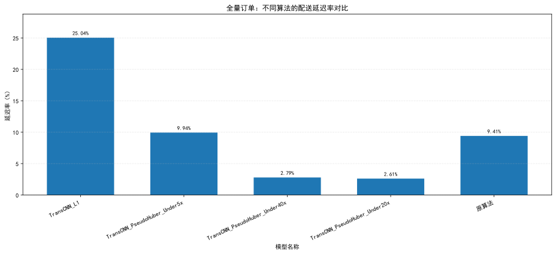

图14 TransformerCNN 全量：延迟率对比 

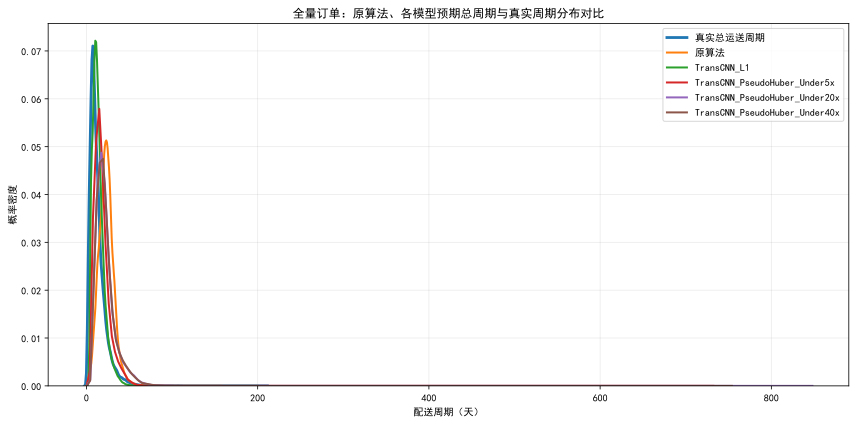

图15 TransformerCNN 全量：不同算法预测周期分布图 

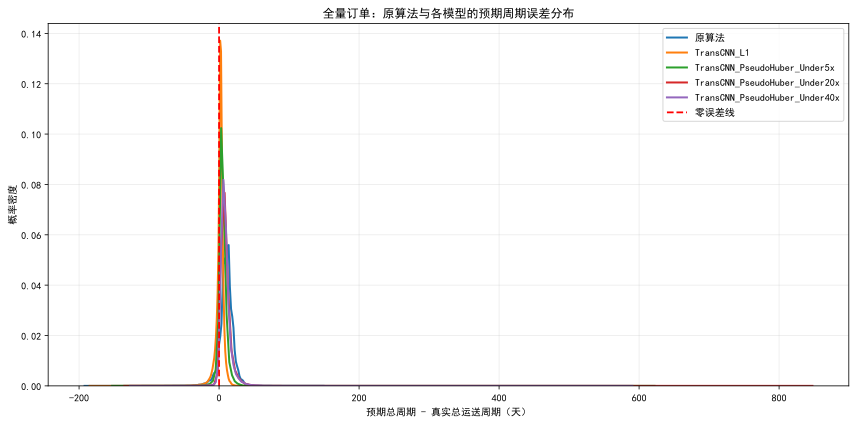

图16 TransformerCNN 全量：不同算法预测误差分布图 

在完整数据上，和 LightGBM 类似，L1 和惩罚较小的 5x 出现了超时率反弹，延迟率回到 26.738% 和 10.408%，都高于原算法的 9.409%，不建议开局便采用。20x 和 40x 仍然把延迟率压在 3.2% 附近，但 MAE 接近 9.7 天，属于比较保守但不够精细的承诺。为了把延迟风险压住，初期还是应当选更保险的策略。

#### 两模型同倍率对比

上一节只是 TransformerCNN 自己和原算法比，还看不出它相对 LightGBM 到底有没有增益。这里把两个模型放到同一组倍率下、按同一套指标并排对照。先看时间外测试期（14,582 条）和全量（72,907 条），两者都是取整后的部署口径：

| 倍率 | LGB MAE | TCNN MAE | MAE 差 | LGB 延迟率 | TCNN 延迟率 | 延迟率差 | LGB 承诺 | TCNN 承诺 |
| ---- | ------ | ------- | ----- | ------- | -------- | ------- | ------- | -------- |
| L1 | 3.743 | 4.218 | +0.476 | 12.399% | 11.658% | −0.741pp | 11.262 | 11.729 |
| 5x | 6.097 | 7.193 | +1.096 | 4.581% | 3.655% | −0.926pp | 14.094 | 15.230 |
| 20x | 8.554 | 10.487 | +1.933 | 2.105% | 1.570% | −0.535pp | 16.735 | 18.705 |
| 40x | 9.834 | 10.443 | +0.609 | 1.687% | 1.769% | +0.082pp | 18.059 | 18.639 |

| 倍率 | LGB MAE | TCNN MAE | MAE 差 | LGB 延迟率 | TCNN 延迟率 | 延迟率差 | LGB 承诺 | TCNN 承诺 |
| ---- | ------ | ------- | ----- | ------- | -------- | ------- | ------- | -------- |
| L1 | 4.002 | 4.092 | +0.090 | 27.209% | 26.738% | −0.471pp | 13.609 | 13.849 |
| 5x | 5.713 | 6.204 | +0.491 | 10.904% | 10.408% | −0.497pp | 17.346 | 17.905 |
| 20x | 8.136 | 9.648 | +1.512 | 3.547% | 3.178% | −0.369pp | 20.511 | 22.077 |
| 40x | 9.313 | 9.687 | +0.375 | 1.845% | 3.152% | +1.307pp | 21.848 | 22.110 |

表中「差」为 TransformerCNN 减 LightGBM，负数代表 TCNN 更低。

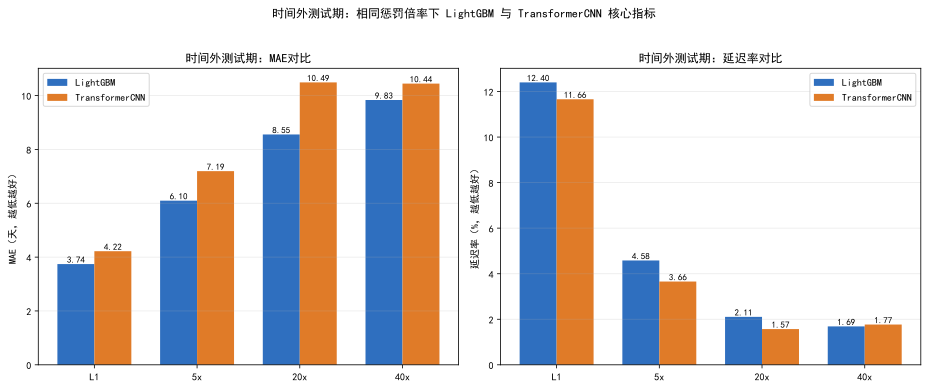

图17 测试期：相同倍率下两模型 MAE 与延迟率对比 

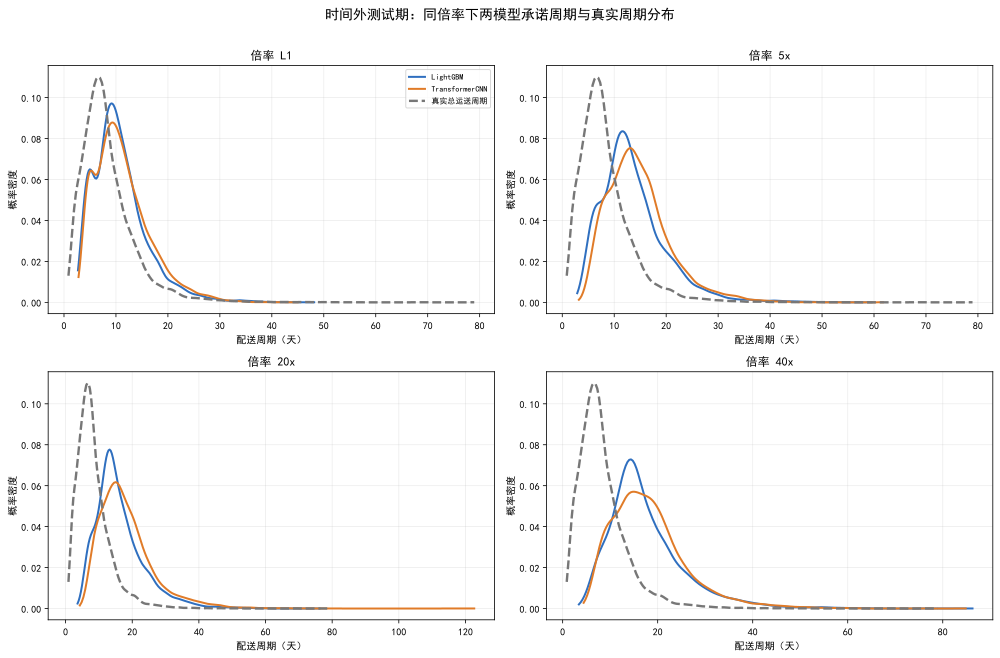

图18 测试期：相同倍率下两模型承诺周期分布对比 

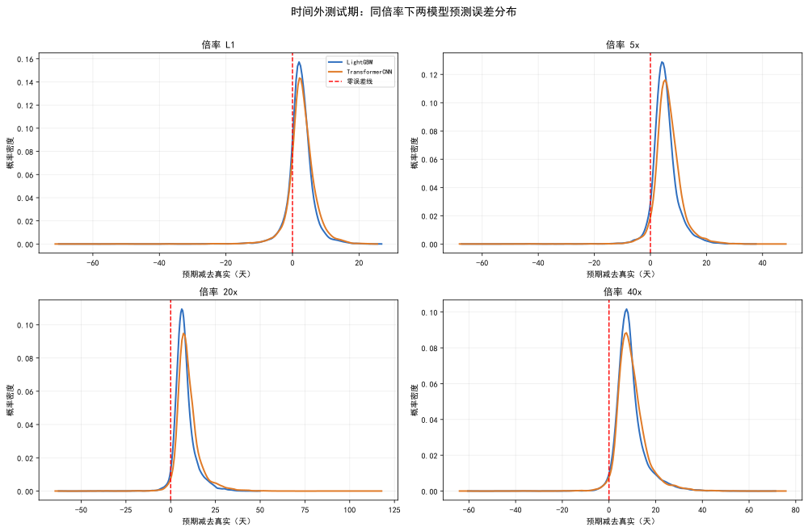

图19 测试期：相同倍率下两模型预测误差分布对比 

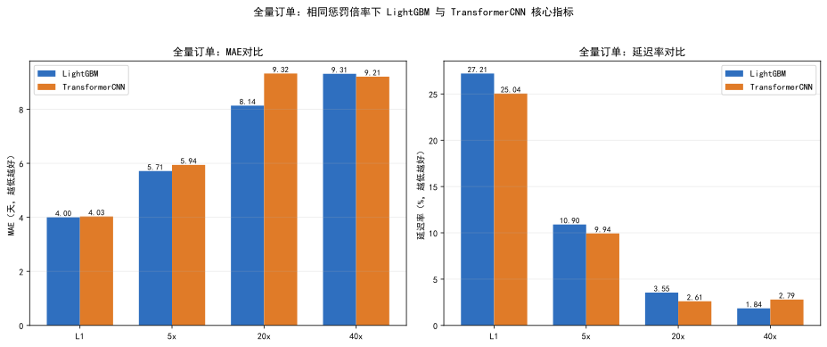

图20 全量：相同倍率下两模型 MAE 与延迟率对比 

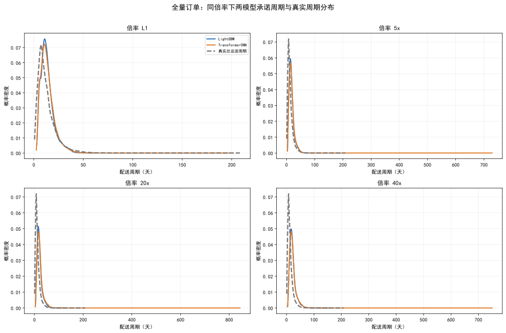

图21 全量：相同倍率下两模型承诺周期分布对比 

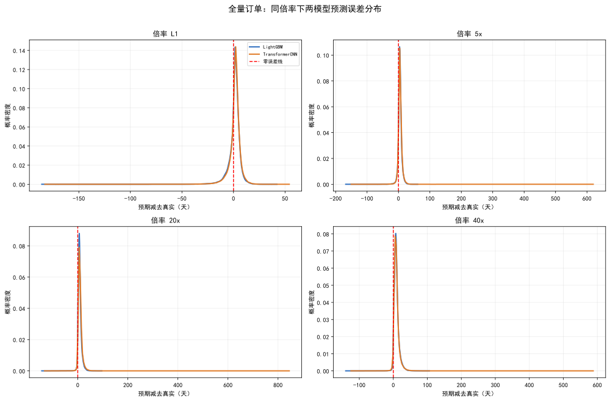

图22 全量：相同倍率下两模型预测误差分布对比 

从上面两张表看，在样本内和测试期，LightGBM 的精度都比 TransformerCNN 好，四个倍率的 MAE 都要低一些，测试期差 0.48 到 1.93 天，全量差 0.09 到 1.51 天。深度模型加了注意力、加了卷积，点估计反而不如树模型准，说明在现在这套特征下，能被预测的信号 LightGBM 基本已经吃干净了，多出来的容量更多是在拟合噪声。

TransformerCNN 在延迟率上有一点优势，但要看清这个优势是怎么来的。测试期 5x、20x 分别低 0.93 和 0.54 个百分点，全量 L1、5x、20x 也都略低，可同期它的承诺均值比 LightGBM 长 0.24 到 1.97 天。说白了就是报得更保守，把误差分布整体往右推，并不是对快慢订单区分得更准，从图18、图21 两条承诺分布曲线的整体错位能看出来。

40x 这一档要留意。它是全量口径下唯一延迟率反超的（3.152% 对 1.845%，高 1.31 个百分点），测试期也从 20x 的领先变成落后。再看直出表，40x 的 MAE 比 20x 还低、延迟率却更高，这种倒挂说明惩罚推到 40 倍时，深度模型的训练和校准已经开始不稳，这一档不建议用。

以上是样本内与测试期口径的对比；真实部署下谁更稳，要结合后面的折外验证一起看。

### 折外验证：模型在真实部署下的表现

上面的全量口径有个隐患：模型是用全量数据训练的，回填出来的预测值里有 80% 是它自己见过的订单，延迟率会被系统性低估。为检验真实部署下的真实水平，按时间序列 5 折前向链重新训练——每一折只用它之前的订单训练，再预测该折，得到 58,326 条折外预测（2017-11-27 ~ 2018-08-29）。三套口径对照如下：

| 口径                  | 样本数    | 原算法   | L1      | 5x     | 20x   | 40x   | 真实均值  |
| ------------------- | ------ | ----- | ------- | ------ | ----- | ----- | ----- |
| 全量（含样本内）           | 72,907 | 9.41% | 27.21%  | 10.90% | 3.55% | 1.84% | 12.72 |
| 时间外测试期（后 20%）      | 14,582 | 6.50% | 12.40%  | 4.58%  | 2.11% | 1.69% | 8.41  |
| 折外（5 折前向链）         | 58,326 | 9.64% | 13.81%  | 8.42%  | 9.09% | 8.91% | 12.63 |

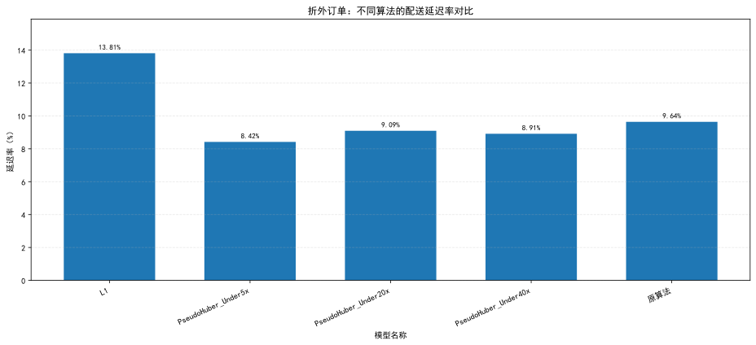

图23 折外订单：不同算法的配送延迟率对比 

落差非常明显：全量口径下 20x 的 3.55% 看着远优于原算法的 9.41%，折外口径下却只差 0.55 个百分点（9.09% vs 9.64%）。时间外测试期的 2.11% 同样偏乐观——那批订单集中在 2018 年中，恰好是全年配送最快的时段。三个口径里，只有折外模拟的是「持续增量训练后预测新单」，也最接近上线后的真实情况。

那么落差从哪来。把同一批折外订单拉出来，比较「最终模型（见过全量）」与「折外模型（只见过过去）」的预测：

| 模型                   | 最终承诺   | 最终延迟率  | 折外承诺   | 折外延迟率 | 承诺变化   | MAE 变化 | 两模型预测相关性 |
| -------------------- | ------ | ------ | ------ | ----- | ------ | ------ | -------- |
| L1                   | 13.59  | 26.78% | 17.01  | 13.81% | +3.43  | +33.3% | 0.725    |
| PseudoHuber_Under5x  | 17.39  | 10.79% | 18.93  | 8.42%  | +1.55  | +18.3% | 0.733    |
| PseudoHuber_Under20x | 20.58  | 3.56%  | 19.11  | 9.09%  | −1.47  | −14.2% | 0.715    |
| PseudoHuber_Under40x | 21.95  | 1.93%  | 19.33  | 8.91%  | −2.61  | −23.0% | 0.683    |

两个现象。其一，各模型的承诺水平向中间收敛：L1 被推长 3.43 天、40x 被推短 2.61 天，全部收到 17~19 天附近，两个模型对同一订单的预测相关系数只有 0.68~0.73，说明折外模型丢失了大量个性化区分能力。其二，激进模型的 MAE 恶化 18%~33%，保守模型的 MAE 反而改善——后者不是变准了，而是它原本系统性高估 8 天，折外下高估幅度缩小，MAE 自然下降，代价是延迟率上升。

真正的原因不在极端订单，而在主力区间的欠承诺。按实际配送时长分桶看 20x 的承诺水平：

| 实际时长区间（天） | 订单数    | 实际均值  | 最终承诺   | 最终延迟率 | 折外承诺   | 折外延迟率 |
| ---------- | ------ | ----- | ------ | ----- | ------ | ----- |
| 0-5        | 9,145  | 3.34  | 10.71  | 0.0%  | 10.38  | 0.6%  |
| 5-10       | 19,847 | 7.39  | 16.25  | 0.2%  | 14.30  | 2.6%  |
| 10-15      | 12,792 | 12.27 | 20.98  | 1.1%  | 17.82  | 9.0%  |
| 15-20      | 6,973  | 17.19 | 24.73  | 3.4%  | 21.81  | 20.5% |
| 20-25      | 4,186  | 22.12 | 29.11  | 8.8%  | 27.15  | 23.3% |
| 25-30      | 2,174  | 27.26 | 34.44  | 15.8% | 33.61  | 22.8% |
| 30-40      | 2,018  | 34.13 | 40.90  | 20.1% | 42.43  | 22.0% |
| 40-60      | 996    | 46.76 | 48.61  | 37.6% | 65.15  | 18.5% |
| 60+        | 195    | 78.23 | 57.81  | 90.8% | 97.29  | 29.7% |

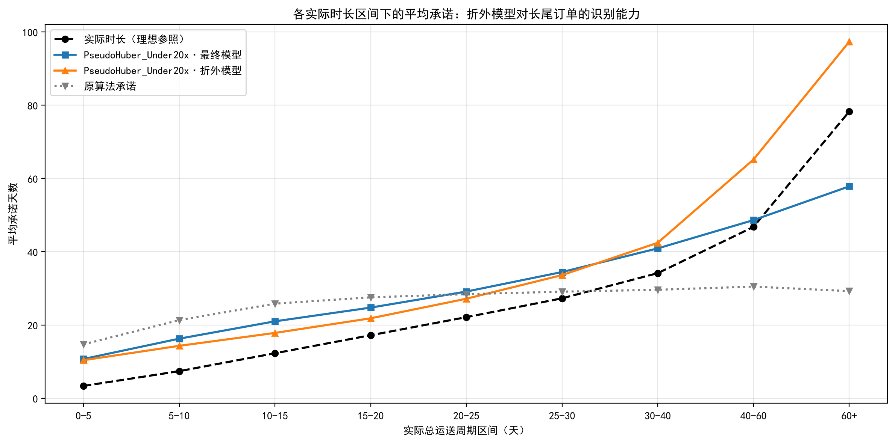

图24 各实际时长区间下的平均承诺：折外模型对长尾订单的识别能力 

折外模型在 10~25 天这个主力区间（占 41% 的订单）承诺比最终模型少 3 天左右，延迟率因此从 1%~9% 抬到 9%~23%；反而在 40 天以上的长尾区间过度承诺，60 天以上的订单实际均值 78.23 天，却给了 97.29 天。延迟率恶化的来源是中间段的校准偏移，不是长尾。

这个偏移的根源是分布漂移。一年内真实配送均值变化极大：

| 月份      | 2017-09 | 2017-11 | 2018-02 | 2018-04 | 2018-06 | 2018-08 |
| ------- | ------- | ------- | ------- | ------- | ------- | ------- |
| 实际均值（天） | 11.83   | 15.15   | 16.96   | 11.63   | 9.24    | 7.74    |

前向链训练意味着模型永远在用「过去一段时期的物流水平」预测下一段，而在 2018 年上半年配送持续变快的背景下，校准必然滞后。加上早期折只有五分之一的训练量，欠拟合进一步削弱了区分度。

#### TransformerCNN 折外验证与双模型对比

TransformerCNN 既然主打时序依赖，就更该拿折外结果说话。把它和 LightGBM 放在同一批 58,325 条折外订单上比（按订单行号对齐，LightGBM 比它多 1 条已剔除）：

| 倍率 | LGB MAE | TCNN MAE | LGB 延迟率 | TCNN 延迟率 | LGB 承诺 | TCNN 承诺 |
| ---- | ------ | ------- | -------- | -------- | ------- | -------- |
| L1 | 5.443 | 4.848 | 13.812% | 35.928% | 17.012 | 12.688 |
| 5x | 6.909 | 7.222 | 8.416% | 12.520% | 18.932 | 18.306 |
| 20x | 7.113 | 10.507 | 9.094% | 6.495% | 19.113 | 22.288 |
| 40x | 7.322 | 10.729 | 8.914% | 6.136% | 19.333 | 22.562 |

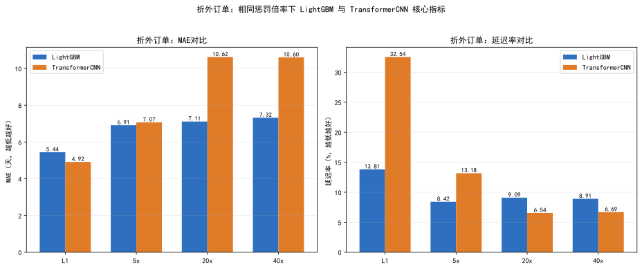

图25 折外订单：相同倍率下两模型 MAE 与延迟率对比 

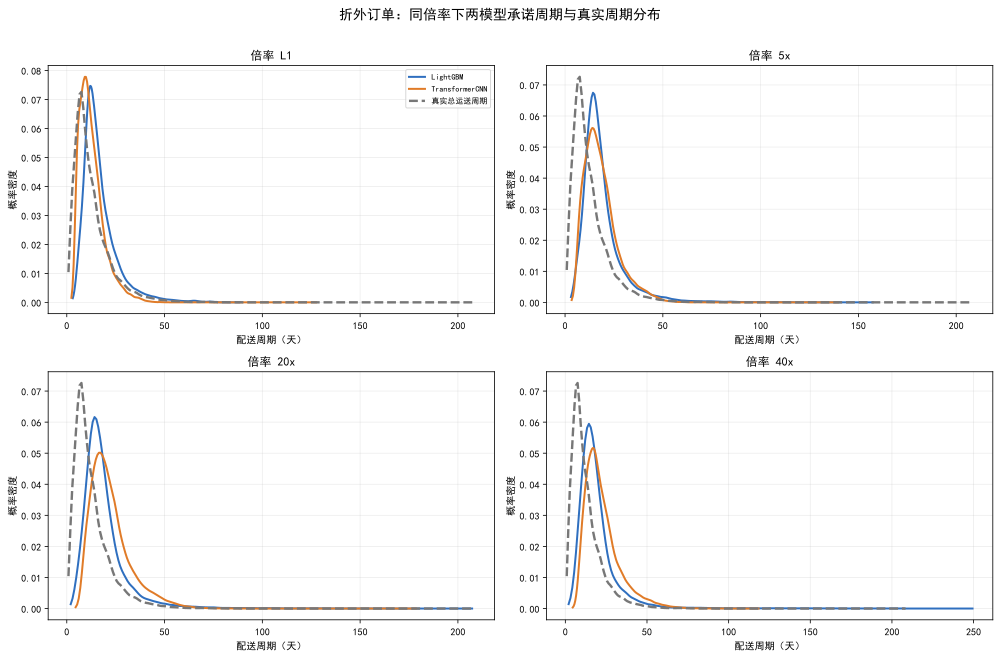

图26 折外订单：相同倍率下两模型承诺周期分布对比 

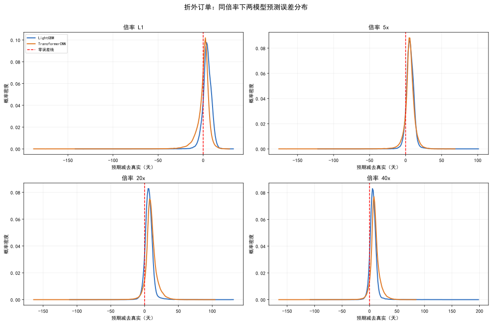

图27 折外订单：相同倍率下两模型预测误差分布对比 

结果出现了反转。高倍率上 TransformerCNN 的延迟率反而更低：20x 是 6.495%，40x 是 6.136%，都低于 LightGBM 的 9.094% 和 8.914%，这是它头一回在延迟风险上真正赢过 LightGBM。但代价也很明显，MAE 高出 3.4 天左右，承诺均值拉到 22.3 天，比 LightGBM 的 19.1 天多出 3 天，靠的还是「报得久」这一招。

低倍率就完全相反。TransformerCNN 的 L1 折外延迟率飙到 35.928%，严重超时率 11.264%，而 LightGBM 只有 13.812% 和 1.630%；5x 也落后（12.520% 对 8.416%）。再联系前面 40x 的倒挂，可以认为深度模型对惩罚倍率更敏感，倍率没选对时波动很大。

把三套口径放一起看延迟率的变化，全量最低、测试期更低、折外回升，这个落差两个模型都有，但幅度不一样：

| 口径 | 倍率 | LGB 延迟率 | TCNN 延迟率 | LGB MAE | TCNN MAE |
| ---- | ---- | -------- | -------- | ------ | ------- |
| 全量（含样本内） | 20x | 3.547% | 3.178% | 8.136 | 9.648 |
| 时间外测试期 | 20x | 2.105% | 1.570% | 8.554 | 10.487 |
| 折外（5 折前向链） | 20x | 9.094% | 6.495% | 7.113 | 10.507 |
| 全量（含样本内） | 40x | 1.845% | 3.152% | 9.313 | 9.687 |
| 时间外测试期 | 40x | 1.687% | 1.769% | 9.834 | 10.443 |
| 折外（5 折前向链） | 40x | 8.914% | 6.136% | 7.322 | 10.729 |

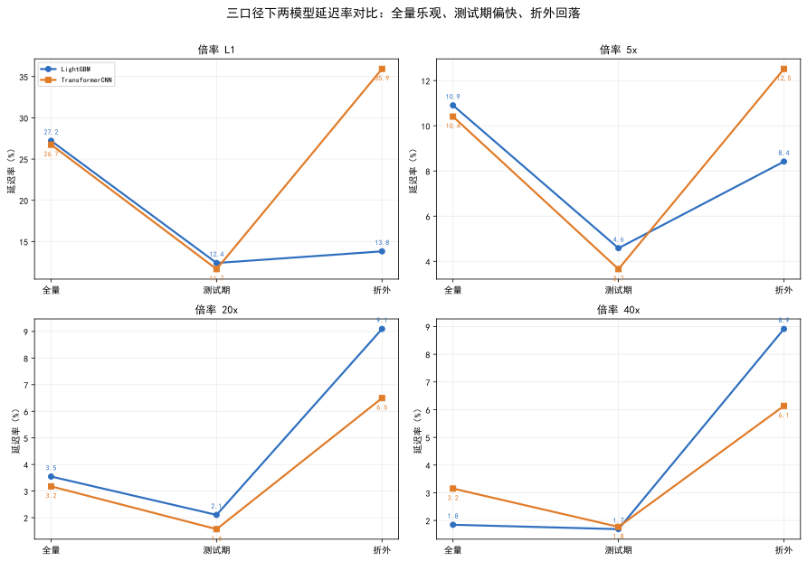

图28 三口径下两模型延迟率对比：全量乐观、测试期偏快、折外回落 

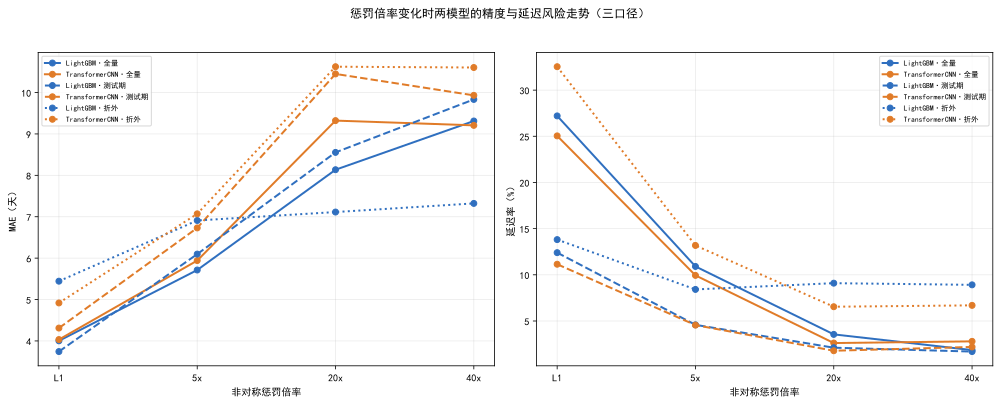

图29 惩罚倍率变化时两模型精度与延迟风险走势（三口径） 

还有一个细节值得说。前面看到 LightGBM 折外模型的承诺明显往中间收敛、两模型预测相关系数只有 0.68 到 0.73；TransformerCNN 的承诺几乎不动，相关系数稳定在 0.87 到 0.90。这说明深度模型的折外预测受训练数据多少的影响更小，跨折更稳定，算是它结构上“能记住长时序”带来的一点回报。不过这份稳定目前只体现在预测一致性上，没变成更高的精度。

综合下来两个模型各有各的用处。LightGBM 的好处是精度高、倍率和延迟率的关系单调可控、训练和迭代都快；不足是时序信息靠人工窗口喂进去，遇到物流水平持续变化，只能靠提高重训频率跟上。TransformerCNN 的好处是折外高倍率的延迟风险更低、跨折预测更稳，理论上面对分布漂移更有潜力；不足是 MAE 全面落后、承诺系统性偏长、倍率一高（40x）就失稳，L1 这种低倍率在折外下更是直接失效，训练成本也高得多。

选型上，现阶段还是建议用 LightGBM 的 `PseudoHuber_Under20x` 作为主方案：精度最好，折外延迟率 9.094% 比原算法的 9.639% 仍有改善，倍率调节可靠，迭代也快。TransformerCNN 暂时更适合当对照和补充，如果后面确实更看重「少延迟」、愿意接受更长的承诺和更高的训练成本，它的 20x、40x 折外结果值得单独做一轮 A/B 实验再决定。

#### 极端离群值：存在，但不该对它们加大惩罚

数据本身确实存在极端离群值。实际总运送周期均值 12.72 天、中位数 10.23 天，但 P99 已达 47.21 天，P99.9 为 77.52 天，最长 208.35 天——最慢的 1% 订单比中位数慢 4.6 倍，偏度 2.81、峰度 19.36，是典型厚尾。

不过模型的预测值本身反而是收敛的。以 20x 为例，它从不主动给出 60 天以上的承诺，对极端订单一律采取「保守但不极端」的处理。这就引出一个问题：训练目标是否对极端离群值加大了惩罚？

答案是否定的，而且是刻意的。非对称 Pseudo-Huber 的梯度为 $\lambda \cdot x / \sqrt{1 + (x/\delta)^2}$，$\delta$ 取 0.2 且作用于对数空间，残差超过 $\delta$ 后梯度就饱和了：

| 对数残差 x | 相对误差    | L1 梯度 | L2 梯度 | 5x   | 20x  | 40x  |
| ------ | ------- | ----- | ----- | ---- | ---- | ---- |
| 0.05   | 5.1%    | 1.00  | 0.05  | 0.24 | 0.97 | 1.94 |
| 0.20   | 22.1%   | 1.00  | 0.20  | 0.71 | 2.83 | 5.66 |
| 0.50   | 64.9%   | 1.00  | 0.50  | 0.93 | 3.71 | 7.43 |
| 1.00   | 171.8%  | 1.00  | 1.00  | 0.98 | 3.92 | 7.84 |
| 1.50   | 348.2%  | 1.00  | 1.50  | 0.99 | 3.96 | 7.93 |

可以看到，残差从 0.5 增长到 1.5（相对误差从 65% 涨到 348%），40x 的梯度只从 7.43 微增到 7.93，几乎不再变化。这意味着极端离群值在损失中的权重被封顶，个别离谱订单无法主导训练。相比之下 L2 的梯度随残差线性增长，正是它容易被离群值带偏的原因。

不需要对极端离群值加大惩罚，理由有三。第一，极端长尾本身就是不可预测的——它们是极端天气、清关、丢件重发这类偶发事件，特征里没有可用信号，加大惩罚只会让模型拟合噪声。第二，极端订单仅占 1%，为它们牺牲另外 99% 常规订单的精度不划算。第三，真正让模型变保守的，已经是「低估方向乘以 20~40 倍」这个非对称权重，而不是对极端值的额外惩罚；两者作用层次不同，混为一谈会导致倍率调错方向。

折外表现不理想，需要改的也不是损失函数。从上面的分桶表能直接读出改进方向：中间段欠承诺是校准问题，应当缩短重训周期（如按月增量训练）、对近期样本加时间衰减权重，让模型的时效基准跟得上物流水平的变化；而不是把极端值惩罚调大——那只会把所有订单的承诺整体抬高，代价由 99% 的常规订单承担。

<!--
#### 虚拟数据验证

## 实际业务整数建模

上阶段我们尝试构造特征变量，多个基于LightGBM的新模型都在不同方面显著改善了原算法。但是目前存在的问题是，模型本身是预测一个运动周期的精确值，而预计送达时间只是一个日期。客户更倾向于得知，在我下完单这一天，第几天能够送达，而不是一个精确的运送周期天数。

虽然原问题最后数据处理的部分，将连续的运送周期通过向上取整取到了一个整数日期，但本身该算法的优化过程是基于原本预测的连续精确数据。所以在此阶段，需要把视角回归到客户本身，从客户的角度来看待延迟率。

### 客户偏好识别

首先我们复用近一年的所有订单信息，统计出客户下单和收货在一天内具体的时刻的大体分布，来识别客户收货和购买的偏好时间：

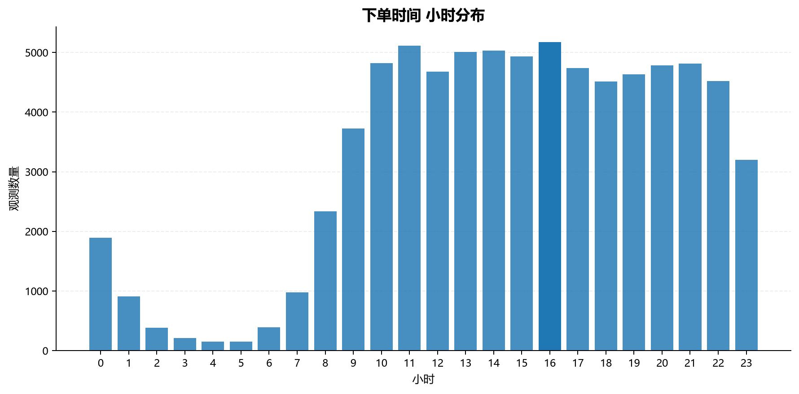

图11 下单时刻分布图 

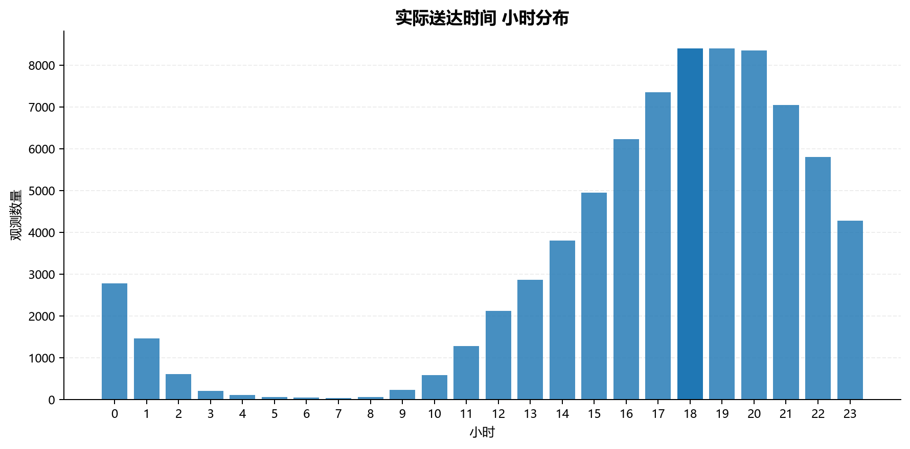

图12 送达时刻分布图 

另外，商家发货时间和系统审核时间的时刻也需要拿出来分析。：

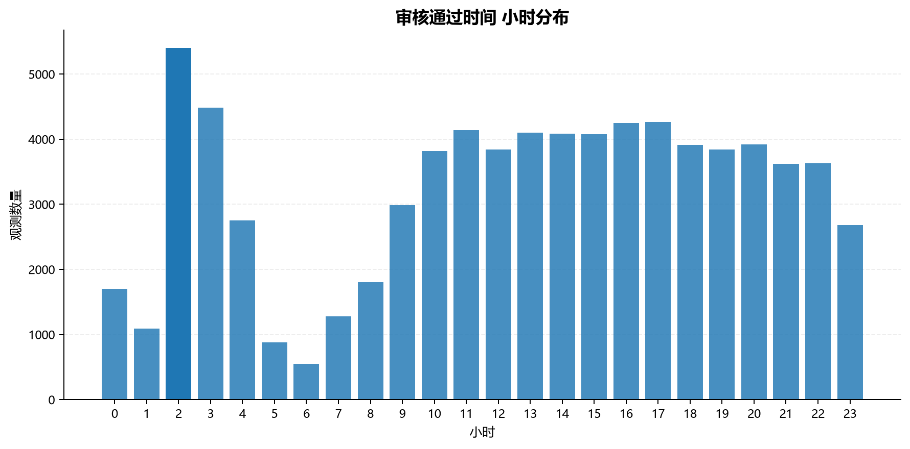

图14 审核通过时刻分布图 

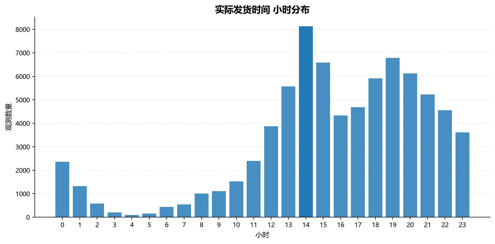

图13 发货时刻分布图 

